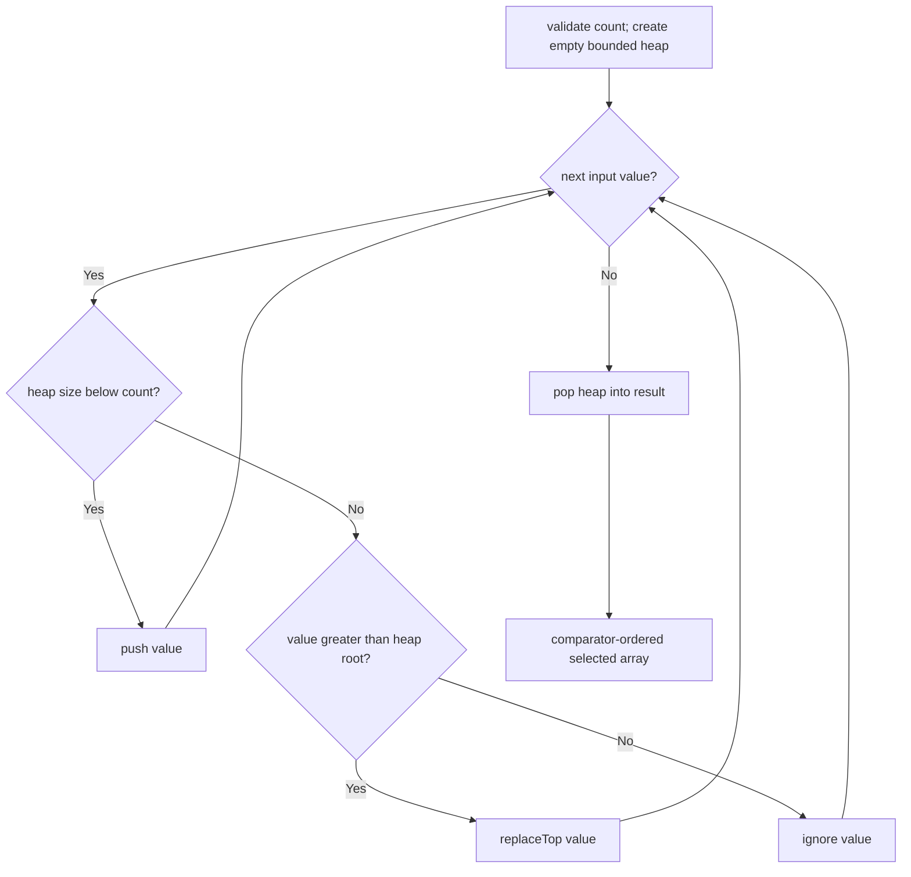

# Top K

**Status:** research-audited exercise specification; implementation and tests remain skipped and
are not public.

## Algorithm Contract

`topK(values, count, compare)` returns the greatest `count` values under `compare`. The selected
result is ordered from smaller to greater according to that comparator.

```ts
topK([5, 1, 4, 2, 3], 2, (left, right) => left - right); // [4, 5]
```

This is an algorithm over any `Iterable<T>`, not an ADT. It consumes the iterable once and does not
modify yielded values or an input array.

## Behavior Rules

1. `count` must be a nonnegative safe integer; invalid counts throw `RangeError`.
2. `count === 0` returns a new empty array.
3. If `count` is at least the number of input values, return all values in comparator order.
4. Duplicates are preserved and count toward the requested result size.
5. Comparator-equal values have no stable-order guarantee.
6. The comparator is interpreted by sign and must define a deterministic, consistent order.
7. The result is always a new array.

## Bounded-Heap Mechanism

Maintain a min-oriented `BinaryHeap<T>` containing at most `count` selected values. Its root is the
smallest value currently accepted into the greatest-value result.



Example for greatest three values:

```text
input value    retained heap values
5              [5]
1              [1, 5]
4              [1, 5, 4]
2              [2, 5, 4]   replace 1
9              [4, 5, 9]   replace 2

result: [4, 5, 9]
```

The diagram shows logical retained values, not the heap's private physical array order.

## Why Not Sort Everything?

Sorting all `n` values costs `O(n log n)` time and stores all `n` values. A bounded heap is useful
when `k` is much smaller than `n` or when the input is a one-pass generator.

| Approach | Time | Extra/result storage |
|---|---:|---:|
| Sort all values | `O(n log n)` | `O(n)` |
| Bounded heap | `O(n log k + k log k)` | `O(k)` |

The final `k log k` term drains the selected heap into ordered output. For `k = 0`, no input values
need to be retained.

## Implementation Guide

1. Complete `BinaryHeap` and `replaceTop` first.
2. Validate `count` before consuming the iterable.
3. Use the caller comparator directly for the bounded min-heap.
4. Replace the root only when the candidate compares greater than it.
5. Drain the heap through `toArray` or repeated pop; do not call native sort.
6. Preserve duplicates by comparing values, not deduplicating them.

## Traceability

| Concern | Source | Verification |
|---|---|---|
| Function signature | `top-k.contract.ts` | TypeScript check |
| Bounded-heap selection | `top-k.ts` | mixed and generator tests |
| Count validation | `top-k.ts` | invalid-count tests |
| Ordering and duplicates | `top-k.ts` | comparator and duplicate tests |

The tests remain skipped until the owner begins this implementation exercise.
