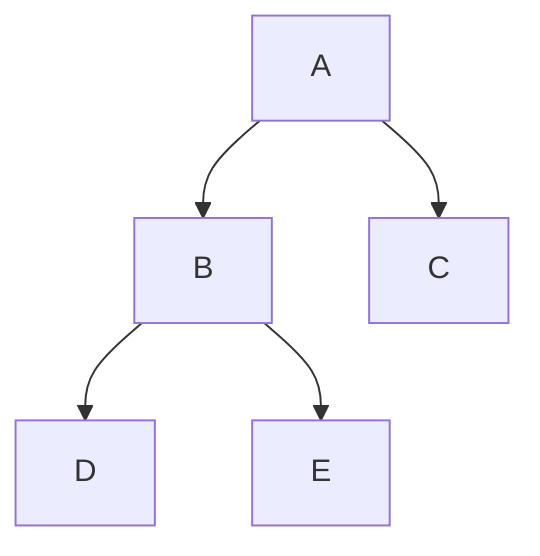
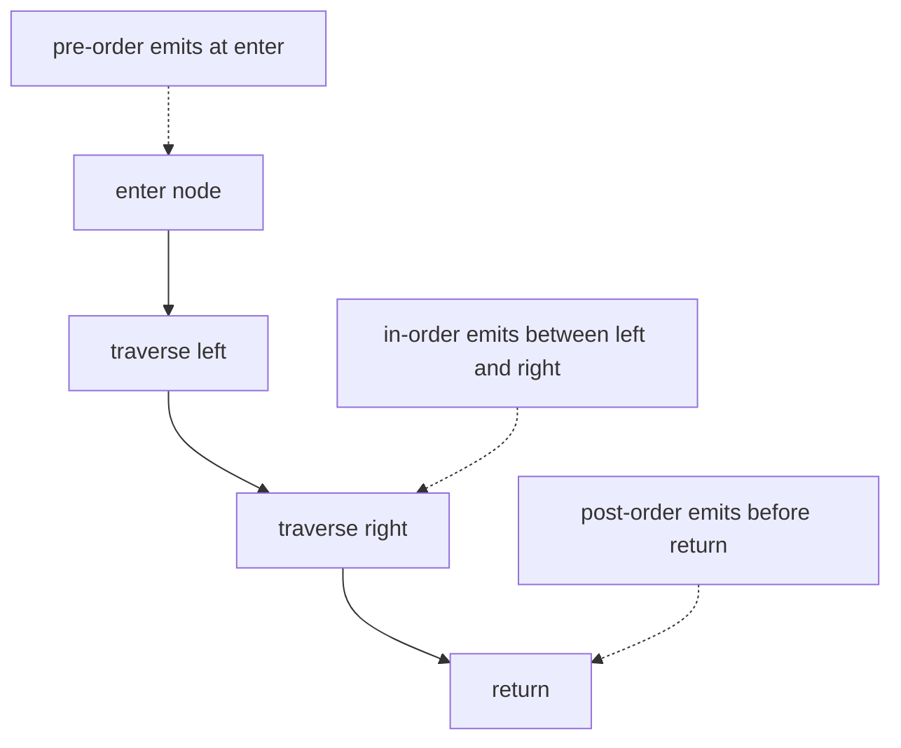
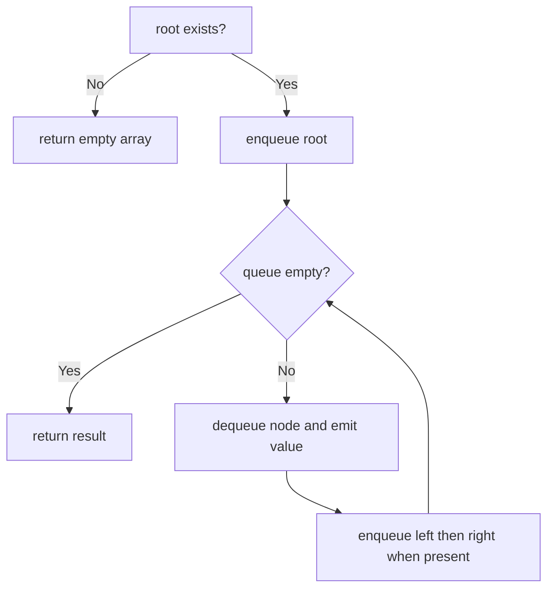

# Binary Tree Traversal

**Status:** research-audited exercise specification; implementations and tests remain skipped and
are not public.

## Contract

A binary tree node contains one value and up to two ordered children. These algorithms accept the
readonly structural shape from `tree-traversal.contract.ts`, return a new value array, and never
change nodes.

```ts
interface BinaryNode<T> {
  readonly value: T;
  readonly left?: BinaryNode<T>;
  readonly right?: BinaryNode<T>;
}
```

Empty input returns `[]`. A shared child or cycle is outside the contract; input must be a tree.

## One Tree, Four Orders



| Traversal | Rule | Result above |
|---|---|---|
| Pre-order | node, left, right | `A, B, D, E, C` |
| In-order | left, node, right | `D, B, E, A, C` |
| Post-order | left, right, node | `D, E, B, C, A` |
| Level-order | each depth, left to right | `A, B, C, D, E` |

## Depth-First Traversals

The three depth-first algorithms differ only in when they emit the current node.



Recursive implementations mirror the definition and use call-stack space proportional to tree
height `h`. A skewed tree can make `h = n`; iterative variants use an explicit stack with the same
asymptotic bound and avoid call-stack limits.

In-order traversal has a special connection to binary search trees: it emits their keys in
comparator order.

## Level-Order Traversal

Level order is breadth-first and uses a queue.



Use an offset queue or the earlier Queue ADT. Repeated native `Array.shift()` would add avoidable
linear movement to each dequeue.

## Complexity

Let `n` be node count, `h` tree height, and `w` maximum width.

| Traversal | Time | Working space | Result space |
|---|---:|---:|---:|
| Pre-order | `O(n)` | `O(h)` | `O(n)` |
| In-order | `O(n)` | `O(h)` | `O(n)` |
| Post-order | `O(n)` | `O(h)` | `O(n)` |
| Level-order | `O(n)` | `O(w)` | `O(n)` |

## Implementation Guide

1. Implement the three recursive depth-first forms to make the visit position obvious.
2. Implement level order with an offset index or reviewed queue implementation.
3. Return a fresh array for every call, including empty input.
4. Do not use value truthiness to detect children; a node value may be `undefined`, `0`, or `false`.
5. Later, iterative depth-first variants may be added as separately named exercises if call-stack
   behavior becomes a practical requirement.

## Traceability

| Concern | Source | Verification |
|---|---|---|
| Readonly node and function type | `tree-traversal.contract.ts` | TypeScript check |
| Four visit orders | four named source files | order tests |
| Empty and one-sided trees | all functions | boundary tests |
| No node mutation | all functions | frozen-node test |

The tests remain skipped until the owner begins this implementation exercise.
