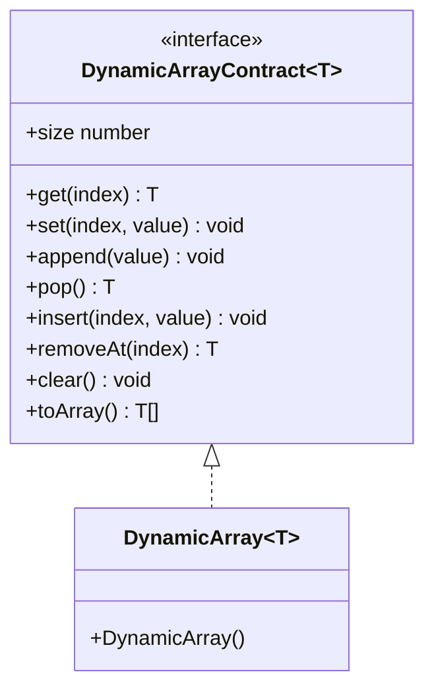
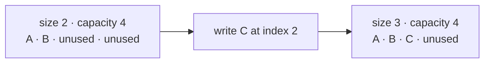
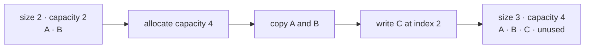
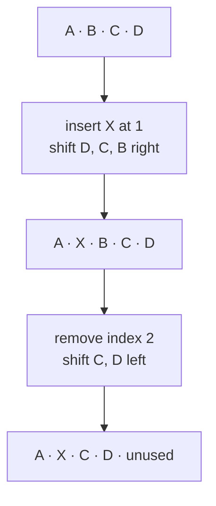

# Arrays And DynamicArray

An array stores values by numeric position. A dynamic array adds and removes logical values while
managing its storage behind that indexed interface.

## Status

- Research audit complete
- Contract, proposed API, diagrams, guidance, and tests prepared
- Concrete `DynamicArray<T>` implementation intentionally incomplete
- Exercise suite skipped until this topic is activated
- Not exported from the package root

## Why Build This

JavaScript already has `Array`, but its storage strategy is controlled by the runtime. Building
`DynamicArray<T>` makes the internal mechanics understandable: logical size, unused storage,
geometric growth, copying, shifting, and reference cleanup.

This implementation is for learning and for a small predictable collection API. It is not a claim
that a custom class will outperform native `Array`.

## JavaScript And The Array Model

- A conventional fixed-size array models a sequence with a set number of indexed positions.
  Languages and runtimes expose that model in different ways.
- `new Array(10)` creates a regular JavaScript `Array` with length 10 and empty positions. It does
  not create a permanently fixed-size collection; its length can still change.
- Typed arrays such as `new Uint8Array(10)` provide fixed-width numeric elements over binary
  storage. They are a closer JavaScript comparison for fixed-size indexed storage, although modern
  resizable buffers add cases that need more careful qualification.
- A regular JavaScript `Array` is dynamically sized from an application developer's point of view.
  The language defines its observable indexed and `length` behavior, while the engine decides how
  values are represented and when internal storage changes.
- AlgoHatch's `DynamicArray<T>` manually models a dynamic array on top of JavaScript storage. It
  exists to make resizing decisions explicit in the implementation exercise, not to replace
  `Array` in normal JavaScript application code.

## Runtime Connection

V8 can represent indexed elements separately from named properties and specialize arrays according
to their contents, whether positions are packed or missing, and whether indexed storage is dense or
sparse. These are V8 implementation choices, not ECMAScript guarantees or requirements for
`DynamicArray<T>`.

See [V8 runtime notes: Arrays](../../../../../../docs/runtime/v8.md#arrays) for the maintained explanation, learning
diagram, practical takeaways, verification date, and official sources.

## Why Capacity Is Private

The implementation needs to distinguish logical size from available storage, but callers do not
need that storage policy to use the collection. `capacity`, an initial-capacity constructor
argument, and the exact growth factor are therefore not part of the public API.

This keeps callers from depending on a particular allocation sequence and leaves room to revise
storage without breaking their code. Tests cross repeated growth boundaries and verify that values
and ordering survive, while implementation review confirms the private resizing mechanics.

## Terms

- **Index:** zero-based logical position of a value.
- **Size:** number of values currently visible to callers.
- **Capacity:** internal number of positions available before storage must grow.
- **Growth:** allocation of larger storage followed by copying logical values.
- **Shift:** moving values right for insertion or left for removal.

For this topic, `n` means the logical size before an operation begins.

## Contract

`DynamicArray<T>` is a mutable, ordered, zero-indexed collection with these rules:

1. Logical indexes are contiguous from `0` through `size - 1`.
2. `get`, `set`, and `removeAt` accept only integer indexes in `[0, size)`.
3. `insert` accepts only integer indexes in `[0, size]`; inserting at `size` appends.
4. Invalid indexes throw `RangeError`.
5. Stored `undefined` is a real value, not an invalid-index signal.
6. Growth preserves every logical value and its order.
7. Removed logical positions must stop retaining their previous values.
8. Iteration and snapshots expose only logical values in index order.
9. Structural mutation during active iteration is outside the first contract.

## Proposed Public API

```ts
interface DynamicArrayContract<T> extends Iterable<T> {
  readonly size: number;

  isEmpty(): boolean;
  get(index: number): T;
  set(index: number, value: T): void;
  append(value: T): void;
  pop(): T | undefined;
  insert(index: number, value: T): void;
  removeAt(index: number): T;
  clear(): void;
  toArray(): T[];
}

class DynamicArray<T> implements DynamicArrayContract<T> {
  constructor();
}
```

## Structure

This is the specification checkpoint, so the diagram names the real public declarations but does
not pretend that private implementation fields already exist.



After the owner implementation is written, add its real private field names and storage mapping to
this diagram.

## Append Without Growth

When the private storage has room, append writes at index `size` and then increases `size`.



## Append With Growth

The recommended first implementation starts with no storage, grows to one position when needed,
and then doubles full storage. Allocate the larger storage, copy the logical values, append the new
value, and replace the old storage. This policy teaches geometric growth but is not a public API
guarantee.



## Insert And Remove

Insertion opens one position by shifting values right from the end toward the insertion index.
Removal closes a position by shifting later values left, then clears the old final logical slot.



Shift direction matters. Moving right from the insertion index forward would overwrite values
before they had been copied.

## Expected Complexity

| Operation | Time | Additional space | Why |
|---|---:|---:|---|
| `size`, `isEmpty` | Worst-case `O(1)` | `O(1)` | Read or derive logical metadata. |
| `get`, `set` | Worst-case `O(1)` | `O(1)` | Access a checked position. |
| `append` | Amortized `O(1)`; worst-case `O(n)` | Usually `O(1)`; growth `O(n)` | Growth occasionally copies all values. |
| `pop` | Worst-case `O(1)` | `O(1)` | Remove the final value without shrinking. |
| `insert` | Worst-case `O(n)` | Growth may use `O(n)` | Later values shift right. |
| `removeAt` | Worst-case `O(n)` | `O(1)` | Later values shift left. |
| `clear` | Worst-case `O(n)` | `O(1)` | Release each logical value reference. |
| iteration | Worst-case `O(n)` | `O(1)` iterator state | Visit each logical value. |
| `toArray` | Worst-case `O(n)` | `O(n)` | Return a new outer array. |

If `c` is the current private capacity, the retained structure uses `O(c)` storage. Big O does not
show the unused positions, so the trade-offs below describe them explicitly.

## Trade-Offs

### Doubling Growth

Doubling is the recommended first implementation because it is easy to reason about and provides
amortized `O(1)` append. It may retain close to the current size in unused positions immediately
after growth. Other growth factors trade fewer unused positions for more frequent copying. Because
the factor is private, a later implementation may change it without changing caller code.

### No Automatic Shrinking

The recommended first implementation keeps its storage after removal. This makes `pop`, `removeAt`,
and `clear` predictable and avoids resize oscillation, but a collection that once held many values
can retain a large backing allocation. Storage reuse remains private and can change later.

### Checked Access

Throwing `RangeError` makes invalid positions distinct from a valid stored `undefined`. Callers who
need optional access can check `size` before reading.

### Native Array As Backing Storage

The implementation may use a JavaScript `Array` as its storage mechanism, but it must manage the
logical size and private capacity itself. The contract does not promise a particular engine memory
layout or that this custom class is faster than native `Array`.

## Test Coverage Prepared

The contract tests cover:

- empty construction;
- empty state and valid stored `undefined`;
- checked reads and replacements;
- value and order preservation across repeated growth;
- insertion at the beginning, middle, and end;
- removal at the beginning, middle, and end;
- empty and non-empty `pop`;
- reuse after removal and `clear`;
- ordered iteration and independent snapshots;
- object identity; and
- a mixed operation sequence that checks state after several transitions.

Tests remain skipped while the class shell is a prepared exercise. Activate the suite when owner
implementation begins; it should then fail until the required behavior is implemented.

## Traceability

| Concern | Source of truth |
|---|---|
| Behavior contract | `dynamic-array.contract.ts` |
| Owner implementation shell | `dynamic-array.ts` |
| Contract and transition tests | `dynamic-array.test.ts` |
| Non-export check | `packages/algohatch/src/public-api.test.ts` |

After implementation, update the structure diagram and this mapping if the real code uses different
names or introduces behavior not covered here.

## Owner Exercise

When this topic is activated, remove `.skip`, implement `DynamicArray<T>` in the provided class
shell, and keep it internal until review passes. Use the tests as executable requirements. If a
requirement appears impractical or unclear, change the contract deliberately rather than changing a
test merely to make it pass.
