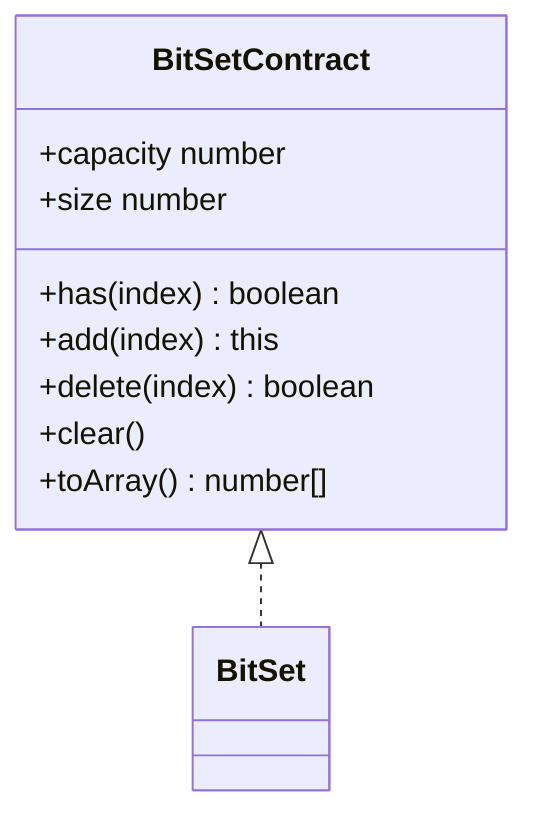
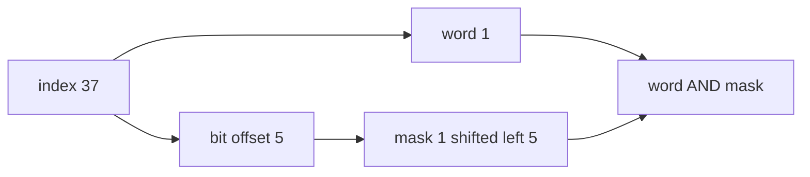

# Bit Set

**Status:** research-audited exercise specification; implementation and tests remain skipped and
are not public.

`BitSet` is an exact set for integer indexes in a fixed domain. `capacity` is the number of valid
indexes; `size` is how many are currently present.

## Packed Representation

Store 32 membership bits per `Uint32Array` word. For index `i`, word index is `floor(i / 32)` and
bit offset is `i % 32`.

JavaScript number bitwise operations use signed 32-bit intermediate results, so a mask for bit 31
appears negative as a Number. That bit is still valid; storing the result in `Uint32Array` preserves
the intended unsigned word pattern.

## Correctness Rules

- Construction accepts a nonnegative safe-integer capacity and allocates `ceil(capacity / 32)` words.
- Valid indexes are safe integers in `[0, capacity)`; invalid input throws `RangeError`.
- `add` is idempotent and increments `size` only on a zero-to-one change.
- `delete` returns true and decrements `size` only on a one-to-zero change.
- Bits beyond capacity in the final storage word are never exposed.
- Iteration and `toArray` return present indexes in ascending order.

Membership/add/delete take `O(1)`. `clear` takes `O(capacity / 32)`. Iteration takes
`O(capacity / 32 + size)` with a word-scanning implementation. Packed storage is
`O(capacity / 32)` words.

Implementation lives in `bit-set.ts`; tests cover cardinality, bit 31/32 boundaries, a partial final
word, ordering, snapshots, clear/reuse, zero capacity, and validation.
