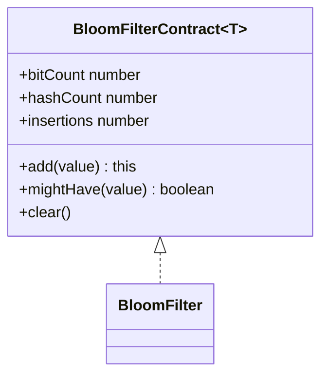
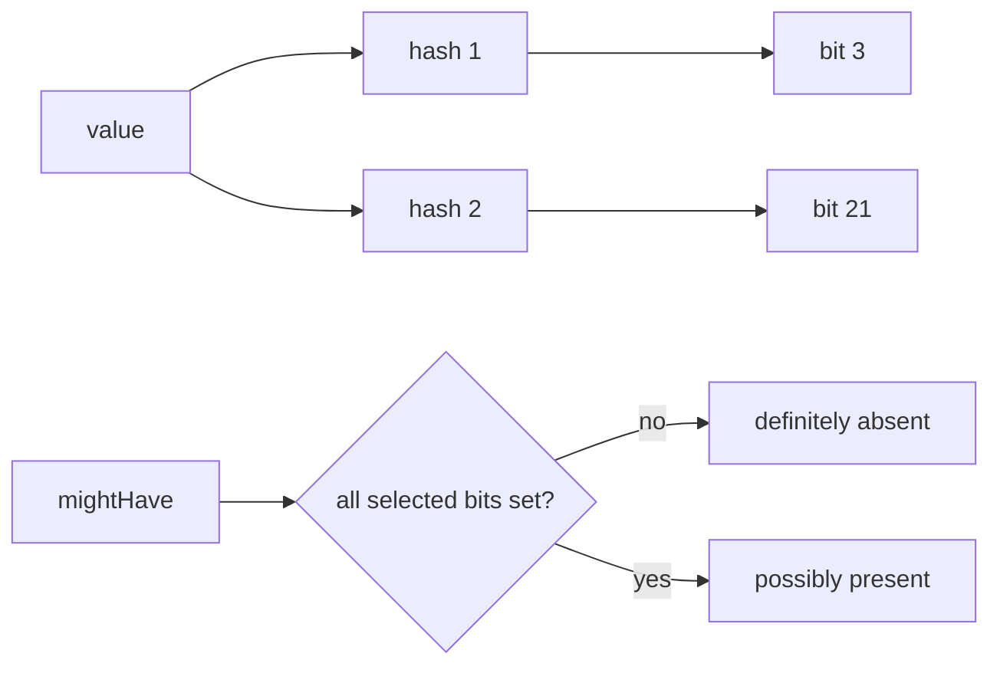

# Bloom Filter

**Status:** research-audited exercise specification; implementation and tests remain skipped and
are not public.

A Bloom filter is a fixed-size probabilistic membership filter. `mightHave(value) === false` means
the value was definitely not added successfully; `true` means it may have been added. Hash
collisions allow false positives, but supported use must not create false negatives.

## Representation

Each hash chooses one position in packed bit storage. Adding sets every selected bit. Querying
returns false as soon as one selected bit is zero.

## Hash Contract

Construction requires a positive safe-integer `bitCount` and at least one callback. Hash callbacks
are snapshotted. Every result must be a safe integer; negative hashes are normalized into the bit
domain. `add` computes and validates all positions before setting any bit so a failing callback
cannot leave a partial insertion.

`insertions` counts successful `add` calls, including repeated values. It is not a distinct-value
count. This basic filter deliberately has no delete operation because clearing a bit shared by
another value could create false negatives.

## Trade-Offs

With `m` bits, `k` hashes, and `n` insertions, the familiar expression
`(1 - exp(-k * n / m))^k` is a useful approximation under independent uniform hashing. It is not a
runtime guarantee: real hash quality, dependence, and finite-size effects matter. More bits reduce
collisions; more hashes initially help but eventually add work and saturate more bits.

Add and query take `O(k)` hash/bit operations. Clear takes `O(m / 32)`. Storage is `O(m)` bits plus
the hash callback snapshot.

Implementation lives in `bloom-filter.ts`; tests cover configuration, no false negatives for added
values, negative hashes, callback snapshots, repeated additions, clear/reuse, and validation.
