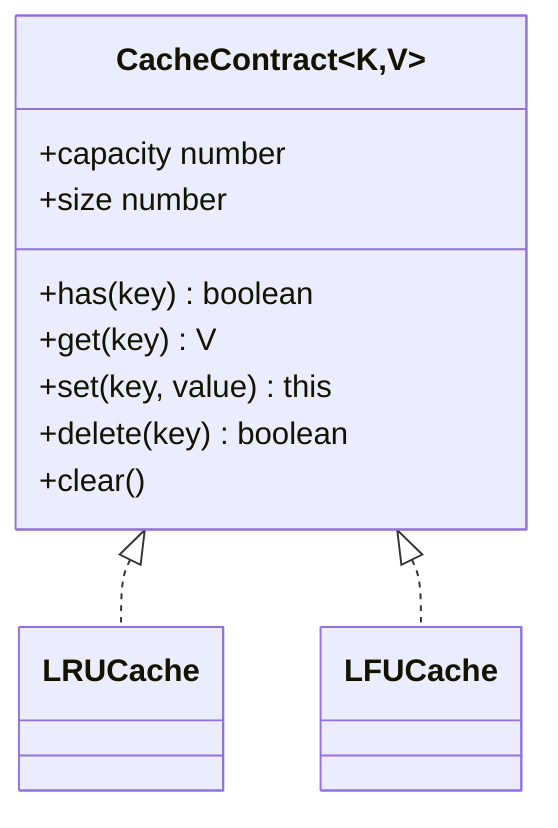

# Bounded Caches

**Status:** research-audited exercise specifications; implementations and tests remain skipped and
are not public.

`LRUCache` and `LFUCache` store at most `capacity` key/value entries and evict automatically when a
new key would exceed that bound.

## Shared Behavior

- Capacity is a nonnegative safe integer. Capacity zero is valid and never stores entries.
- Keys use SameValueZero equality. Replacement retains the first key representative.
- Values may be `undefined`; use `has` to distinguish presence from absence.
- `has` is observational and does not update recency or frequency.
- Successful `get` counts as use. Replacing through `set` updates the value and counts as use.
- Iteration starts with the next eviction candidate and returns snapshot entries.
- `delete` and `clear` remove all associated policy metadata.

## Choosing A Policy

LRU favors entries used most recently and reacts quickly to changing access patterns. LFU favors
entries used repeatedly over time and may preserve historically popular entries; its LRU tie-break
keeps eviction deterministic. Neither policy includes expiration, async loading, size weights, or
disposal callbacks in this focused learning contract.

| Operation | Target time | Storage |
|---|---:|---:|
| `has`, `get`, `set`, `delete` | expected `O(1)` | `O(capacity)` total |
| `size`, `isEmpty` | `O(1)` | - |
| iteration, `clear` | `O(n)` | iterator/result dependent |

## Topic Pages

- [LRU Cache](./lru-cache/)
- [LFU Cache](./lfu-cache/)

Shared API and tests remain at this family level. Each implementation folder contains its source
and GitHub-rendered README.
