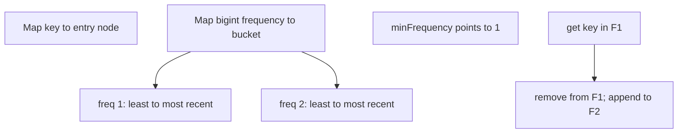

# LFU Cache

`LFUCache` evicts the least frequently used entry. When several entries share minimum frequency,
it evicts the least recently used among them.

Each frequency bucket is a doubly linked list. Entry nodes store key, value, exact bigint frequency,
and bucket links. The cache tracks the minimum nonempty frequency so eviction does not scan all
buckets. New entries start at frequency one.

## Correctness Rules

- Every entry belongs to exactly one frequency bucket and the key lookup map.
- Bucket order is least to most recent for tie-breaking.
- Successful get and replacement increment frequency exactly once and refresh bucket recency.
- Removing the final node from a bucket removes that bucket and updates minimum frequency.
- Inserting a new key resets minimum frequency to one after any eviction.
- Iteration uses ascending frequency and bucket recency, matching eviction priority.

Bigint counters avoid unsafe Number overflow while remaining private. Expected get/set/delete are
`O(1)`; full eviction-order iteration is `O(n)` if active frequencies are linked or otherwise
maintained without sorting at iteration time.

Implementation lives in `lfu-cache.ts`. The shared cache contract runs from `../cache.test.ts`;
frequency eviction, LRU ties, replacement-as-use, and eviction-order cases live in
`lfu-cache.test.ts`.
