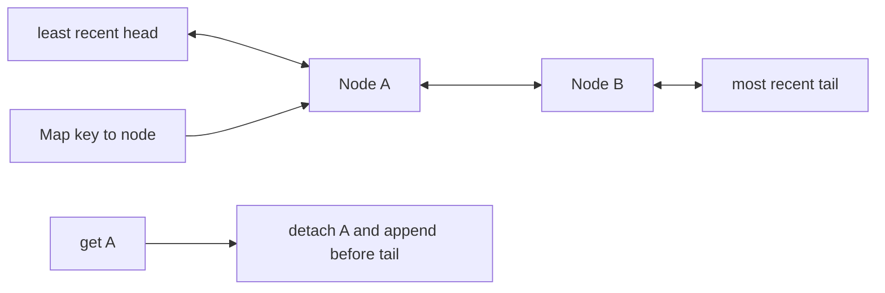

# LRU Cache

`LRUCache` evicts the least recently used entry. A successful `get` or replacement `set` makes an
entry most recent; `has` does not.

Use a SameValueZero `Map<K, Node>` plus a doubly linked list. List endpoints should be sentinels or
carefully centralized helpers so detach/append/evict do not duplicate pointer cases.

## Correctness Rules

- Every map entry points to exactly one list node and every list node is in the map.
- List order is least to most recent.
- Refreshing a node changes no key identity and no size.
- Inserting a new key at full positive capacity removes exactly the head candidate first or after
  insertion consistently, leaving `size === capacity`.
- Iteration walks least to most recent and returns entry snapshots.

Expected operation time is `O(1)` and storage is `O(capacity)`. Implementation lives in
`lru-cache.ts`. The shared cache contract runs from `../cache.test.ts`; focused recency and
eviction cases live in `lru-cache.test.ts`.
