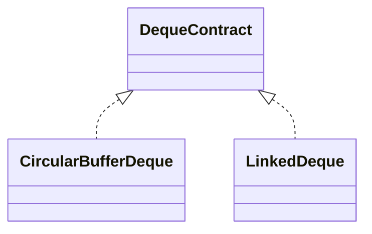

# Deque

A deque adds, reads, and removes values at both ends. This family README defines the shared ADT;
each implementation folder explains one storage strategy.

## Behavior Contract

1. Pushes add at the named end; peeks inspect without mutation; pops remove from the named end.
2. Empty peeks and pops return `undefined` without mutation.
3. Stored `undefined` is valid and is distinguished with `size`.
4. Iteration and `toArray()` run front-to-back; snapshots are independent.
5. `clear()` releases retained values and leaves the deque reusable.
6. Structural mutation during active iteration is unsupported.
7. Capacity, indexes, and nodes remain private.

## Implementations

- [CircularBufferDeque](./circular-buffer-deque/): wrapped indexed storage and geometric growth.
- [LinkedDeque](./linked-deque/): doubly linked head and tail nodes.

| Operation | Circular buffer | Linked deque |
|---|---:|---:|
| size, emptiness, peeks | Worst `O(1)` | Worst `O(1)` |
| pushes | Amortized `O(1)` | Worst `O(1)` |
| pops | Worst `O(1)` | Worst `O(1)` |
| clear, iteration, snapshot | Worst `O(n)` | Worst `O(n)` |

Both use `O(n)` storage. Circular storage may retain capacity; linked storage adds two links per
node. Shared mixed-end and boundary behavior is verified by `deque.test.ts`.
