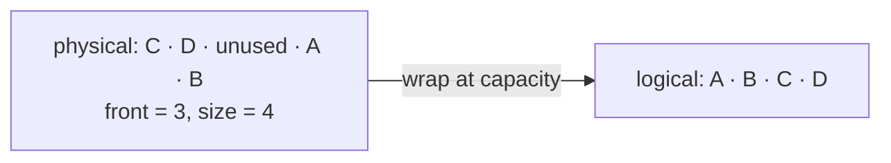

# CircularBufferDeque

`CircularBufferDeque<T>` maps logical front-to-back order onto wrapped physical storage. Both ends
can move without shifting existing values.

Pushes and pops are normally `O(1)`. A full-buffer growth copies logical order into larger storage,
making pushes amortized `O(1)`. Storage is `O(n)` with potentially unused retained capacity.

**Implementation guide:** choose one empty convention, implement one-value transitions first, test
wrap-around before growth, clear removed slots, and reset indexes after growth/clear. Source is
`circular-buffer-deque.ts`; shared tests are in `../deque.test.ts`.
