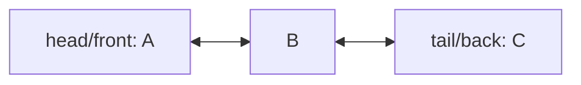

# LinkedDeque

`LinkedDeque<T>` stores previous and next links, with head as the logical front and tail as the
logical back.

Pushes, pops, and peeks are worst-case `O(1)`. Storage is `O(n)` with one node and two links per
value. There is no growth copy, but every mutation must preserve reciprocal links.

**Implementation guide:** empty-to-one and one-to-empty transitions update both ends; a new end has
no outward link; removed nodes retain neither neighbor nor deque. Source is `linked-deque.ts`; shared
tests are in `../deque.test.ts`.
