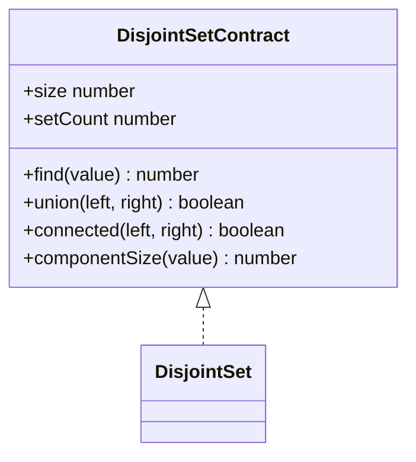
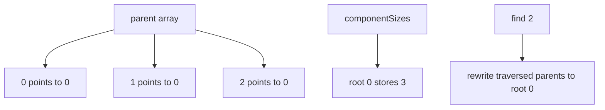

# Disjoint Set

**Status:** research-audited exercise specification; implementation and tests remain skipped and
are not public.

## Practical ADT

`DisjointSet` maintains a partition of fixed integer members `0` through `size - 1`. It answers
whether two members belong to the same component and merges components without storing their full
member lists.

`find` returns a current representative. The representative is useful for equality comparison but
is not a stable or caller-selected identifier; later unions may change it. `union` returns `true`
only when two previously separate components merge.

## Representation

Store parallel `parent` and `componentSizes` arrays. A root is its own parent, and only a root's
component size is authoritative.

## Correctness Rules

1. Construction creates `size` singleton components and `setCount === size`.
2. Every parent chain terminates at a valid root in the same component.
3. `union` links roots only, attaches the smaller component below the larger, and decrements
   `setCount` exactly once.
4. Path compression changes representation but never component membership.
5. `componentSize` returns the size stored at the member's current root.
6. Every member argument must be a safe integer in `[0, size)`; invalid input throws `RangeError`.

Construction takes `O(n)` time and space. With union by size and path compression, an intermixed
sequence of operations costs `O(alpha(n))` amortized per operation, effectively constant for
practical input sizes. `size` and `setCount` access are `O(1)`.

## Implementation Guide

1. Validate a nonnegative safe-integer size and initialize both arrays.
2. Implement iterative root finding to avoid recursion depth limits.
3. Compress the traversed path fully or use path halving consistently.
4. In `union`, find both roots before comparing component sizes.
5. Implement `connected` and `componentSize` through `find` so they share validation/compression.

Implementation lives in `disjoint-set.ts`; `disjoint-set.test.ts` verifies singleton state,
merges, repeated unions, component sizes, empty domains, and bounds.
