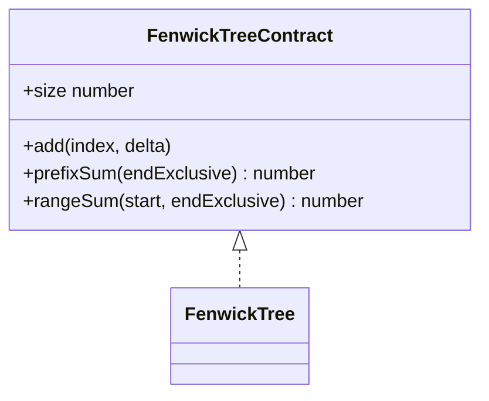
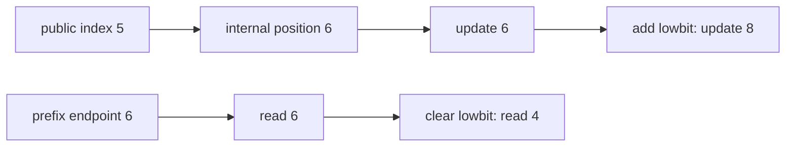

# Fenwick Tree

**Status:** research-audited exercise specification; implementation and tests remain skipped and
are not public.

`FenwickTree` maintains finite numeric values under point addition and prefix/range sum queries.
Public indexes are zero-based and ranges are half-open.

Construction accepts either a nonnegative safe-integer size for zero-filled values or a readonly
array that is snapshotted. `prefixSum(0)` is zero and `prefixSum(size)` covers all values. Empty
valid ranges return zero.

## Representation

Use an internal one-based numeric array. Position `i` stores the sum of a block whose length is the
least significant set bit of `i`.

## Correctness Rules

- Internal block sums equal the values in their represented ranges.
- `add(index, delta)` changes exactly one conceptual value and every covering block.
- `rangeSum(start, end)` equals `prefixSum(end) - prefixSum(start)`.
- Constructor values and deltas must be finite numbers.
- Sizes, indexes, and bounds must be safe integers in range; invalid input throws `RangeError`.

Array construction should use linear forward propagation in `O(n)`, not `n` logarithmic updates.
Point updates and prefix/range queries take `O(log n)` time; storage is `O(n)`.

Implementation lives in `fenwick-tree.ts`; `fenwick-tree.test.ts` covers snapshot construction,
zero construction, endpoint behavior, negative deltas, empty ranges, and validation.
