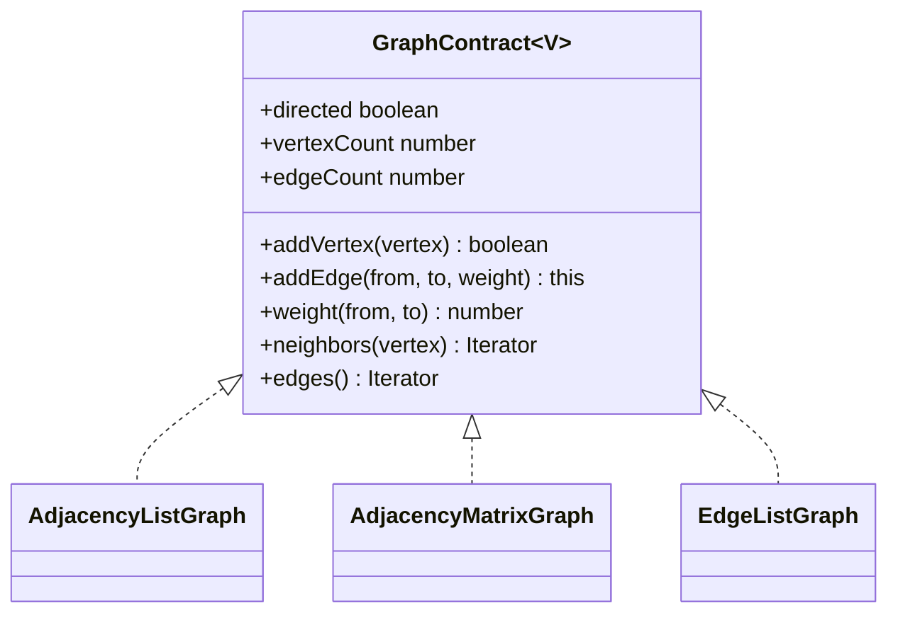

# Weighted Graph

**Status:** research-audited exercise specifications; implementations and tests remain skipped and
are not public.

## Practical ADT

The graph stores SameValueZero vertices and finite weighted edges. Construction chooses directed or
undirected behavior. It is a simple graph: self-loops are allowed, parallel edges are not.

`addEdge` automatically adds missing endpoints. Re-adding an existing logical edge replaces its
weight without changing count or insertion position. Negative and zero weights are valid storage;
individual algorithms may impose stricter requirements.

For undirected graphs, `(u, v)` and `(v, u)` identify one logical edge. `edges()` yields it once in
the orientation first inserted. A self-loop is one edge and one neighbor entry.

## Ordering And Snapshots

- Vertices iterate in insertion order and retain their first SameValueZero representative.
- Edges iterate in first insertion order.
- Neighbors iterate by incident edge insertion order.
- Weight replacement does not move an edge; deletion and re-addition does.
- Neighbor tuples and weighted edges are snapshots.

`neighbors` throws `RangeError` for a missing vertex. Membership, weight lookup, and deletion return
false or `undefined` for absent endpoints/edges.

## Representation Trade-Offs

| Operation | Adjacency list | Matrix | Edge list |
|---|---:|---:|---:|
| edge lookup/update | expected `O(1)` | `O(1)` | `O(E)` |
| neighbors | `O(degree)` | `O(V)` | `O(E)` |
| all edges | `O(E)` | `O(E)` with sequence metadata | `O(E)` |
| add vertex | expected `O(1)` | `O(V^2)` matrix growth | expected `O(1)` |
| delete vertex | `O(V + E)` practical | `O(V^2)` | `O(V + E)` |
| storage | `O(V + E)` | `O(V^2)` | `O(V + E)` |

## Topic Pages

- [Adjacency List](./adjacency-list-graph/)
- [Adjacency Matrix](./adjacency-matrix-graph/)
- [Edge List](./edge-list-graph/)

The shared contract and parameterized tests remain at this family level. Each representation folder
contains its source and GitHub-rendered README.
