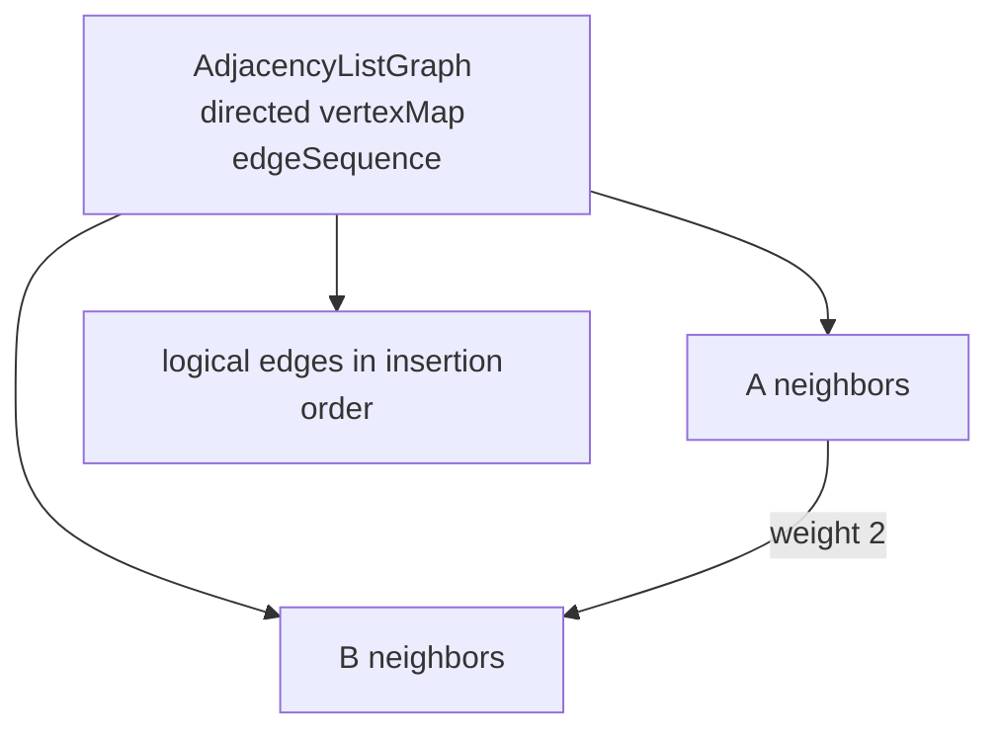

# Adjacency List Graph

`AdjacencyListGraph` stores one insertion-ordered neighbor map per vertex and separate logical-edge
sequence metadata.

For undirected non-self edges, update both endpoint neighbor maps but count/store one logical edge.
Use shared edge records so weight replacement remains synchronized. Vertex deletion must remove all
incoming and outgoing records, including directed incoming edges not present in its own neighbor map.

Expected vertex/edge lookup and update are `O(1)` with map-backed storage. Neighbor traversal is
`O(degree)`, full traversal `O(V + E)`, and storage `O(V + E)`.

Implementation lives in `adjacency-list-graph.ts`; shared representation behavior is in
`graph.test.ts`.
