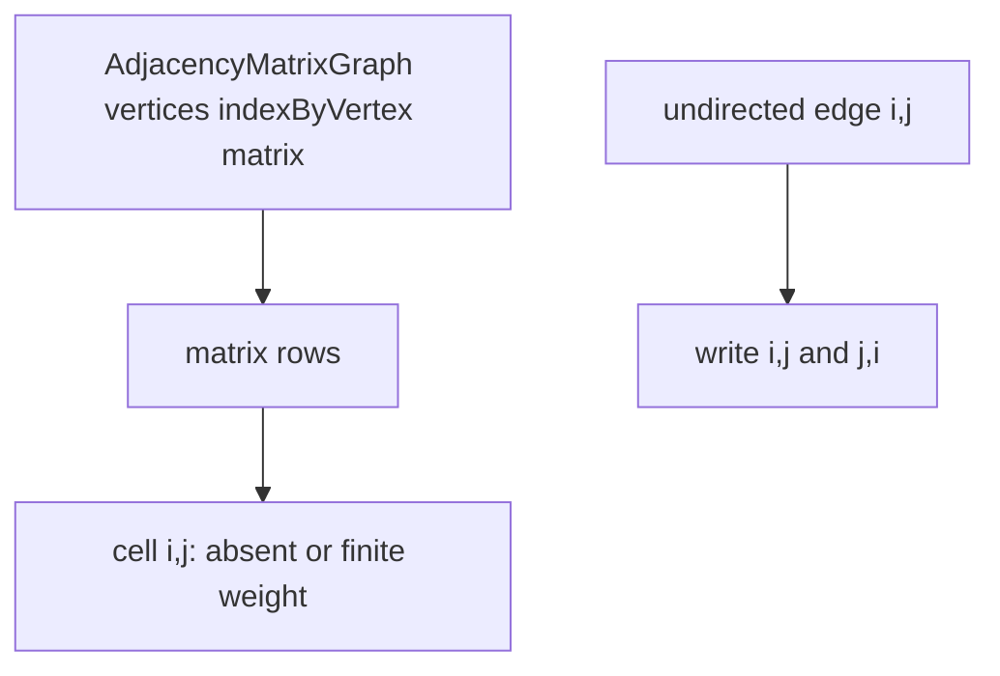

# Adjacency Matrix Graph

`AdjacencyMatrixGraph` maps each vertex to a row/column and stores edge presence separately from
weight so a zero-weight edge is not confused with absence.

The dynamic learning contract preserves insertion order after deletion, so removing a vertex
compacts its row and column and rebuilds shifted indexes. Keep separate logical-edge sequence data
to preserve the shared edge iteration order and first undirected orientation.

Edge lookup is `O(1)` and neighbors require `O(V)` scanning. Matrix growth/deletion is `O(V^2)`;
storage is `O(V^2)`, making this representation appropriate for dense graphs or representation
comparison rather than sparse default use.

Implementation lives in `adjacency-matrix-graph.ts`; shared behavior is in `graph.test.ts`.
