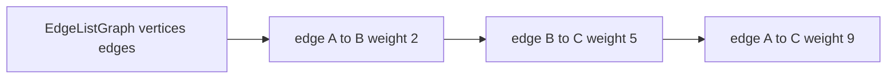

# Edge List Graph

`EdgeListGraph` stores insertion-ordered vertices and one record per logical edge. It is the simplest
representation for algorithms that primarily sort or scan all edges.

Edge lookup, replacement, neighbor discovery, and edge deletion scan the list. Undirected matching
checks both endpoint orientations while preserving the orientation of the stored record. Vertex
deletion filters all incident records.

Whole-edge iteration is `O(E)` with low structural overhead. Edge lookup and neighbor traversal are
`O(E)`. Storage is `O(V + E)`.

Implementation lives in `edge-list-graph.ts`; shared behavior is in `graph.test.ts`.
