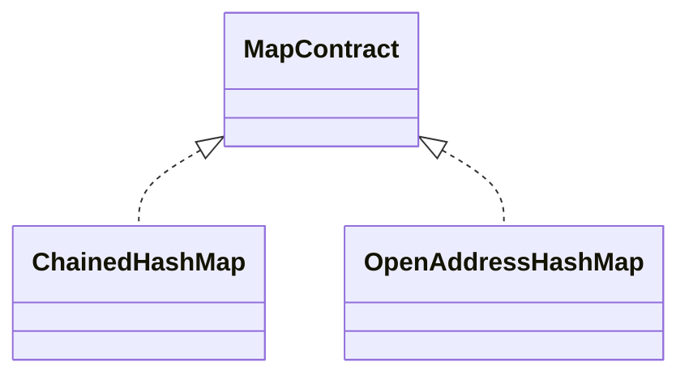

# Hash Map

A hash map associates equal keys with values and uses a caller-supplied hash to narrow lookup.
This family compares two collision strategies behind one `MapContract<K,V>`.

## Shared Contract

1. `set` inserts or replaces and returns the same map; replacing keeps size unchanged.
2. `get` returns a value or `undefined`; `has` distinguishes absence from stored `undefined`.
3. `delete` returns whether an entry existed; `clear` leaves the map reusable.
4. Key equality uses the optional callback or SameValueZero by default.
5. Equal keys must produce the same hash, and the first equal key representative is retained.
6. Hash results must be safe integers; negative hashes are normalized internally.
7. Entry snapshots have `{ key, value }` shape. Iteration order is unspecified and may change after
   resize or deletion.
8. Structural mutation during active iteration is unsupported.

## Implementations

- [ChainedHashMap](./chained-hash-map/): colliding entries share a bucket.
- [OpenAddressHashMap](./open-address-hash-map/): linear probing searches one slot table.

Assuming a useful hash and bounded load, lookup, insertion, and deletion are expected `O(1)` for
both implementations and worst-case `O(n)`. Resizing is `O(n)` and makes insertion amortized
expected `O(1)`. Retained storage is `O(n + capacity)`.

The shared equality, collision, deletion, growth, iteration, and invalid-hash suite is
`hash-map.test.ts`. Implementation-specific tests belong in child folders when activated.
