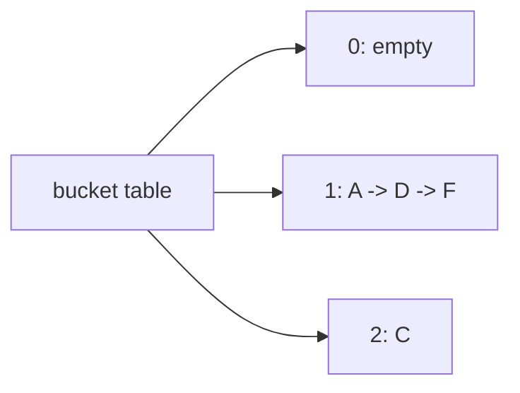

# ChainedHashMap

`ChainedHashMap<K,V>` stores entries whose normalized hashes select the same index in one bucket.

A lookup scans only the selected bucket. Growth allocates a larger bucket table and rehashes every
entry because normalized indexes depend on capacity. With a useful hash and bounded load, operations
are expected `O(1)`; adversarial collisions make them `O(n)`.

**Implementation guide:** centralize safe-integer hash validation/normalization, compare both hash
and key equality inside a bucket, retain the first key representative on replacement, and rebuild
all bucket links during growth. Source is `chained-hash-map.ts`; shared tests are in
`../hash-map.test.ts`.
