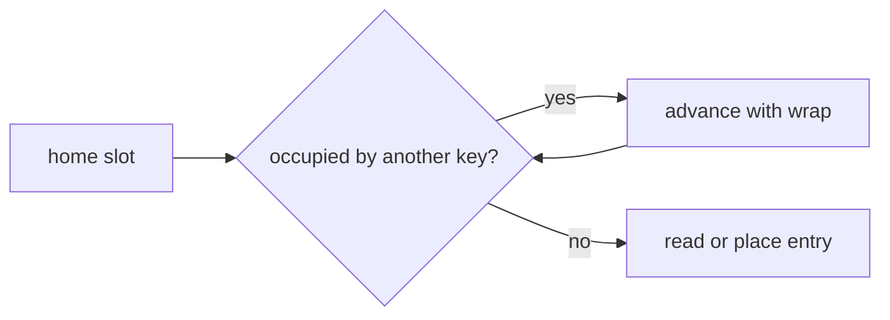

# OpenAddressHashMap

`OpenAddressHashMap<K,V>` keeps entries directly in one slot array and resolves collisions through
linear probing.

Slots need three distinguishable states: never used, occupied, and deleted. Lookup may stop at a
never-used slot but must cross deleted slots; insertion may reuse the first deleted slot only after
checking that the key does not appear later in the probe cluster.

Expected operations are `O(1)` under bounded load and a useful hash, with `O(n)` worst case. Growth
must reinsert entries because every probe home depends on capacity.

**Implementation guide:** track live and deleted counts separately, preserve probe chains during
deletion, reset tombstones during rehash, and retain the first equal key representative. Source is
`open-address-hash-map.ts`; shared tests are in `../hash-map.test.ts`.
