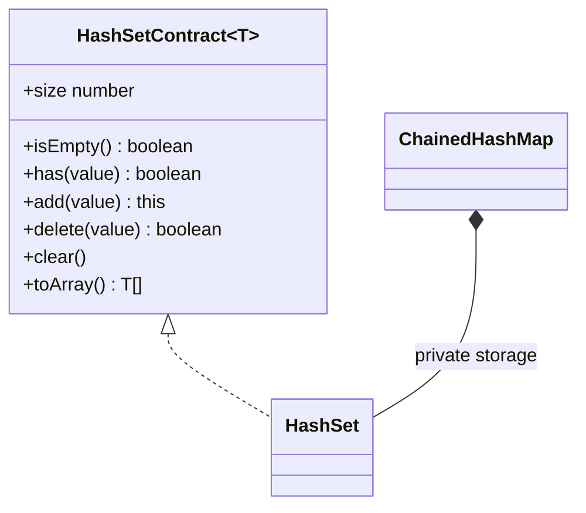
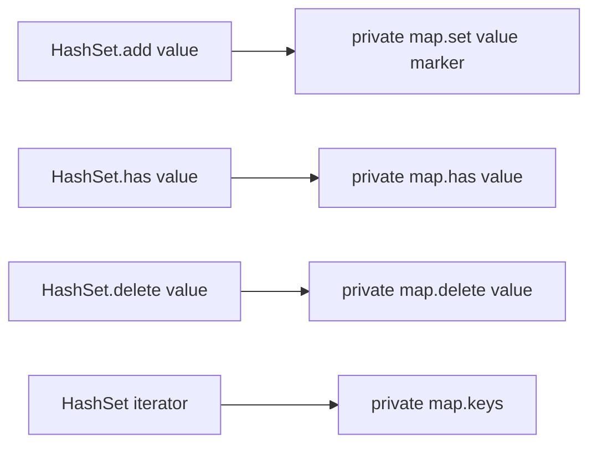
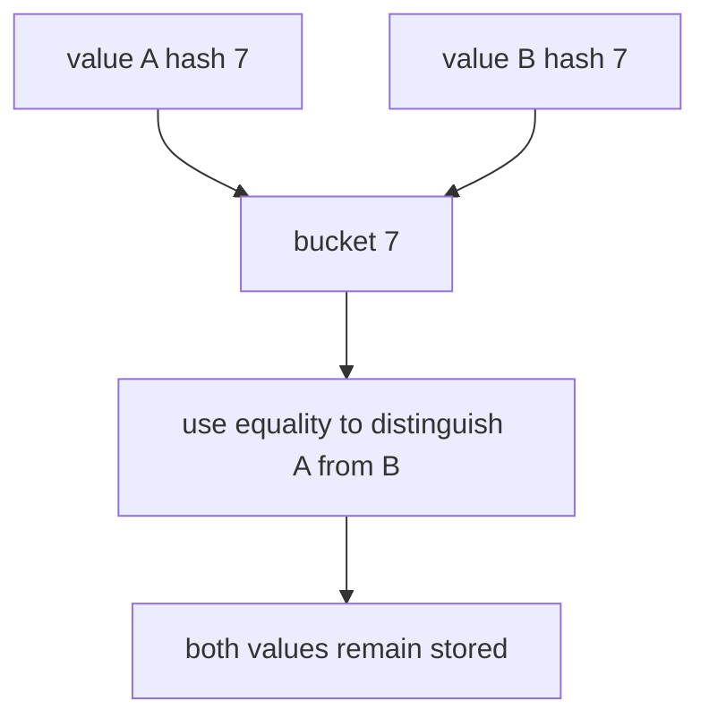

# Hash Set

**Status:** research-audited exercise specification; implementation and tests remain skipped and
are not public.

## Practical ADT

A set stores at most one representative of each group of equal values. Adding an equal value again
does not change `size`. A hash set is useful for membership checks, deduplication, and recording
which values have already been visited.



## Proposed API

```ts
new HashSet<T>(hash: HashFunction<T>, equals?: Equality<T>);
```

The class implements `HashSetContract<T>` from `hash-set.contract.ts`.

## Behavior Rules

1. `size` counts distinct values.
2. `add` returns the set and is idempotent for an equal value.
3. Adding an equal but different object retains the originally stored representative.
4. `delete` returns `true` only when a value existed.
5. Omitted equality uses SameValueZero.
6. The hash function follows the same safe-integer and equality-consistency rules as Hash Map.
7. Iteration and `toArray` contain every distinct value exactly once.
8. Iteration order is unspecified and may change after internal map resizing.
9. `toArray` returns an independent outer array.

## Representation

`HashSet` should compose `ChainedHashMap<T, true>` (or an equivalent private marker) and delegate
membership mechanics. It should not reimplement buckets, resizing, and collision handling.



This composition keeps one source of truth for hashing while still teaching that a set can be
modeled as a map whose values carry no user information.

## Collision Example



A hash collision does not make values equal. Only the equality callback decides membership.

## Expected Complexity

| Operation | Expected | Worst case |
|---|---:|---:|
| `size`, `isEmpty` | `O(1)` | `O(1)` |
| `has`, `add`, `delete` | `O(1)` amortized | `O(n)` |
| `clear`, iteration, `toArray` | `O(n)` | `O(n)` |
| Storage | `O(n)` | `O(n)` |

The expected bounds require a useful hash and controlled map load. `toArray` always allocates
`O(n)` result storage.

## Implementation Guide

1. Complete and test `ChainedHashMap` first.
2. Store one private map instance configured with the same hash and equality callbacks.
3. Delegate `size`, membership, deletion, clear, and key iteration.
4. Verify stored `undefined`, `NaN`, signed zero, and collision cases.
5. Do not wrap native `Set`; the exercise is specifically tied to the AlgoHatch hash map.

## Traceability

| Concern | Source | Verification |
|---|---|---|
| Public shape | `hash-set.contract.ts` | TypeScript check |
| Map composition | `HashSet` in `hash-set.ts` | shared behavior tests |
| Idempotency and equality | `HashSet.add` | duplicate/equality tests |
| Independent snapshot | `HashSet.toArray` | snapshot test |

The tests remain skipped until the owner begins this implementation exercise.
