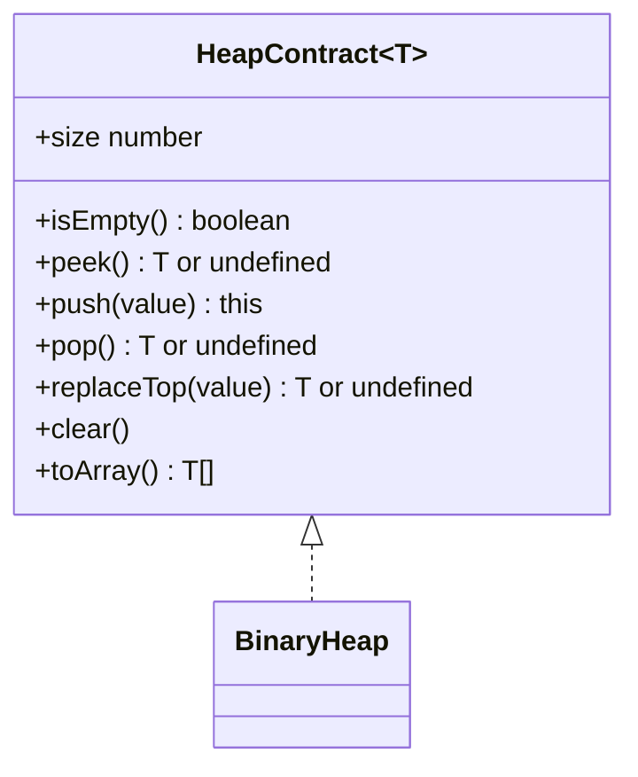
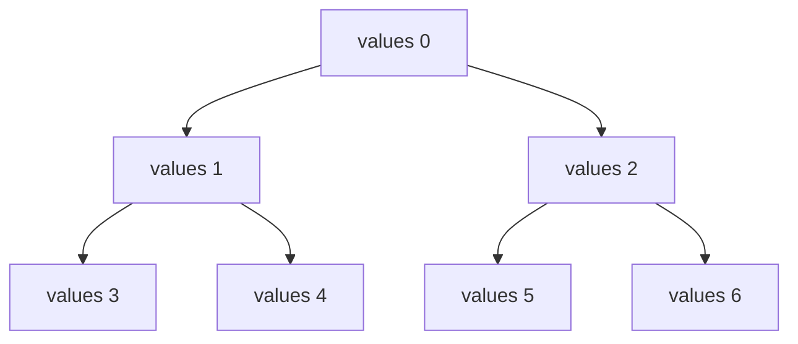
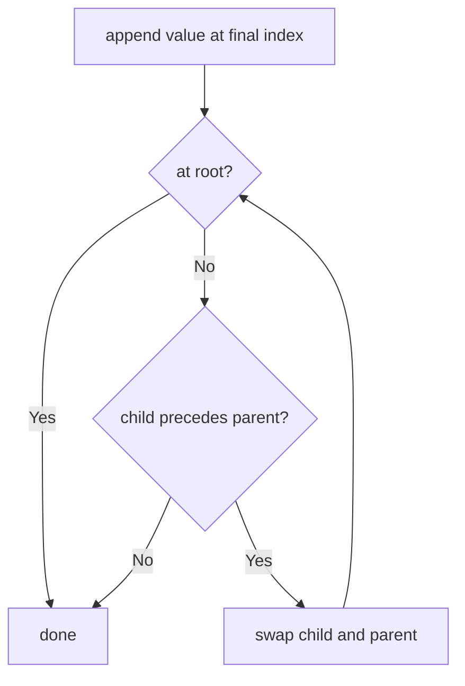
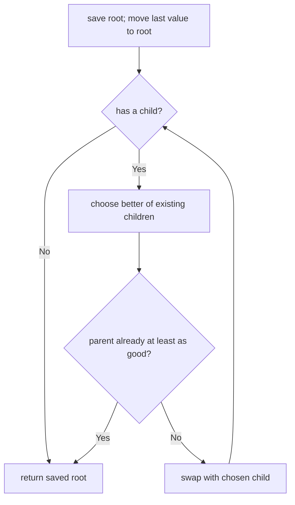

# Binary Heap

**Status:** research-audited exercise specification; implementation and tests remain skipped and
are not public.

## Practical ADT

A heap keeps one comparator-best value available without globally sorting every stored value.
`BinaryHeap<T>` is orientation-neutral:

```ts
new BinaryHeap<number>((left, right) => left - right); // minimum first
new BinaryHeap<number>((left, right) => right - left); // maximum first
```

Whenever `compare(left, right) < 0`, `left` has higher heap precedence than `right`.



## Behavior Rules

1. Empty `peek` and `pop` return `undefined`.
2. `push` stores duplicates and returns the heap.
3. `replaceTop` removes and returns the current top, then inserts the supplied value.
4. On an empty heap, `replaceTop(value)` inserts `value` and returns `undefined`.
5. Optional constructor input is copied and never mutated.
6. `toArray` and iteration return values in comparator order without changing the heap.
7. Equal-comparator values have no stable ordering guarantee.
8. Structural mutation during active iteration is unsupported.

The comparator must be deterministic and consistent. Do not mutate compared fields of an object
while it is stored; the heap cannot detect that its order became invalid.

## Array Representation

Recommended private field: `values: T[]`, storing a complete binary tree in level order with the
root at index zero.

```text
tree indexes:              0
                         /   \
                        1     2
                       / \   / \
                      3   4 5   6

parent(i)     = floor((i - 1) / 2)
leftChild(i)  = 2 * i + 1
rightChild(i) = 2 * i + 2
```



For every child, its parent must have equal or better comparator precedence. Siblings and cousins
are not globally sorted.

## Push: Move Up

Append at the end to preserve the complete-tree shape. Then repeatedly exchange with the parent
while the new value has better precedence.



Only one root-to-leaf-height path can change, so push is `O(log n)`.

## Pop: Move Down

Remove the root, move the last array value to index zero, then exchange it with the better child
until order is restored.



Choosing the better child is necessary. Exchanging with the wrong child can leave the other child
above a worse parent.

## Replace Top

For a non-empty heap, replacing index zero followed by one move-down pass combines a pop and push
without changing size. This is useful for bounded-heap algorithms such as top-k selection.

```text
non-empty: return old root, store new root, move down
empty:     store value, return undefined
```

## Bottom-Up Construction

The optional constructor iterable must be copied, then heapified from the final parent down to the
root. Leaves already satisfy heap order.

```mermaid
flowchart RL
  LastParent[floor(length / 2) - 1] --> MoveDown[move node down]
  MoveDown --> Previous[previous parent index]
  Previous --> More{index at least zero?}
  More -->|Yes| MoveDown
  More -->|No| Heap[heap complete]
```

Although one move-down can cost `O(log n)`, most nodes are near the leaves. Total bottom-up build
time is `O(n)`, unlike repeated push at `O(n log n)`.

## Iteration And Snapshots

The internal level-order array is private and is not comparator-sorted. `toArray` and iteration
must clone the heap and repeatedly pop from the clone, yielding comparator order while preserving
the original heap.

## Expected Complexity

| Operation | Time | Extra/result space |
|---|---:|---:|
| `size`, `isEmpty`, `peek` | `O(1)` | `O(1)` |
| `push`, `pop`, `replaceTop` | `O(log n)` | `O(1)` beyond array growth |
| constructor build | `O(n)` | `O(n)` copied storage |
| `clear` | `O(n)` | `O(1)` |
| `toArray`, full iteration | `O(n log n)` | `O(n)` |
| retained storage | `O(n)` | `O(n)` |

Array growth makes a particular push `O(n)` when copying storage, while push remains amortized
`O(log n)` and comparison work remains `O(log n)`.

## Implementation Guide

1. Implement index arithmetic helpers for the zero-based representation.
2. Implement a comparator-sign helper; do not assume results are exactly `-1`, `0`, or `1`.
3. Implement move-up, then push and peek.
4. Implement choose-better-child and move-down, then pop and replaceTop.
5. Add bottom-up constructor heapification rather than calling push in a loop.
6. Implement sorted snapshots by operating on a private clone.
7. Never call native `sort` to implement heap iteration; use heap removal so the exercise remains
   traceable to the data structure.

## Traceability

| Concern | Source | Verification |
|---|---|---|
| API | `heap.contract.ts` | TypeScript check |
| Array heap and repair paths | `BinaryHeap` in `heap.ts` | mixed push/pop tests |
| Bottom-up construction | constructor | iterable and input-preservation tests |
| Empty replacement | `replaceTop` | transition tests |
| Sorted non-mutating views | `toArray`, iterator | snapshot/order tests |

The tests remain skipped until the owner begins this implementation exercise.
