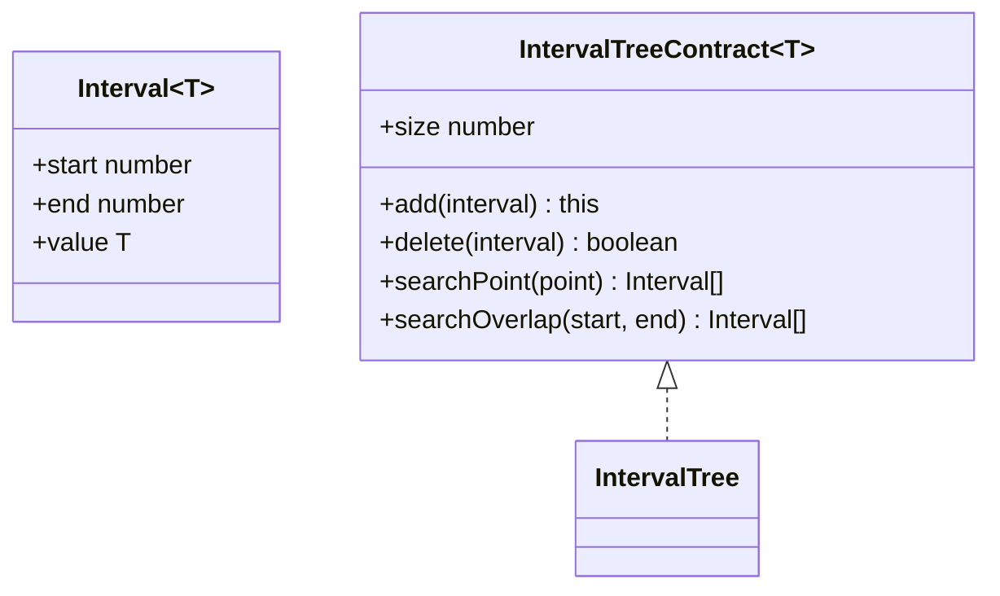
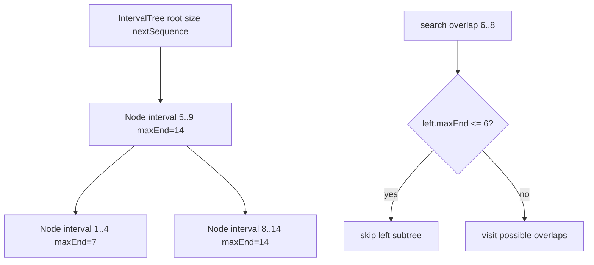

# Interval Tree

**Status:** research-audited exercise specification; implementation and tests remain skipped and
are not public.

## Practical ADT

`IntervalTree<T>` stores finite, nonempty half-open numeric intervals `[start, end)` with attached
values. It reports intervals containing a point or overlapping another half-open interval.

Half-open semantics mean `start <= point < end`. Two intervals overlap when each starts before the
other ends. `[1, 3)` and `[3, 5)` only touch and do not overlap.

## Duplicates And Ordering

Adding snapshots the record, so later mutation of the caller object cannot corrupt tree ordering.
Duplicates are retained. `delete` removes the earliest-added record with equal numeric endpoints
and an `Object.is`-equal value. Iteration and query results sort by start, then end, then insertion
sequence.

## Augmented Representation

Use a height-balanced search tree ordered by `(start, end, sequence)`. Each node additionally stores
the greatest `end` anywhere in its subtree.

## Correctness Rules

1. Every stored interval has finite endpoints with `start < end`.
2. Search-tree order includes private sequence so duplicate endpoints remain distinct.
3. Each node's `maxEnd` is the maximum of its end and both child `maxEnd` values.
4. Rotations and deletion repairs update height/balance data and `maxEnd` before returning.
5. Query pruning cannot discard a subtree containing a possible match.
6. Returned records are independent snapshots.

Add and delete target `O(log n)` time. Reporting queries are output-sensitive when augmentation
prunes unrelated subtrees, commonly `O(log n + k)` for `k` results, but may visit `O(n)` nodes when
many intervals overlap or the data offers little pruning. Storage is `O(n)`.

## Implementation Guide

1. Reuse knowledge from AVL trees, but implement interval-specific nodes and augmentation locally.
2. Centralize record validation and composite-key comparison.
3. Centralize metadata recomputation and call it after every structural change.
4. For overlap traversal, use `maxEnd` to decide whether the left subtree can contain a match and
   ordered starts to decide whether rightward traversal can stop.
5. Collect results in tree order so no final sort is required.

Implementation lives in `interval-tree.ts`; `interval-tree.test.ts` covers endpoint semantics,
duplicates, mutation isolation, ordering, deletion, clear/reuse, and invalid inputs.
