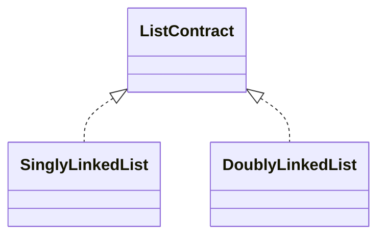

# Linked List

A linked list is an ordered mutable sequence stored in connected nodes. Reaching an index requires
following links, while end operations expose the practical differences between representations.

## Shared Contract

1. `first` and `last` inspect ends; prepend/append and end removals mutate them.
2. Empty end removals return `undefined`; stored `undefined` remains valid.
3. `get`, `set`, and `removeAt` accept safe integer indexes in `[0,size)`.
4. `insert` accepts safe integer indexes in `[0,size]`; invalid indexes throw `RangeError`.
5. Iteration and `toArray()` run front-to-back; snapshots are independent.
6. `clear()` detaches logical values and leaves the list reusable.
7. Nodes and links are private, and structural mutation during active iteration is unsupported.

## Implementations

- [SinglyLinkedList](./singly-linked-list/): each node points only toward the tail.
- [DoublyLinkedList](./doubly-linked-list/): each node has reciprocal previous/next links.

| Operation | Singly linked | Doubly linked |
|---|---:|---:|
| size, emptiness, first, last | Worst `O(1)` | Worst `O(1)` |
| prepend, append, remove first | Worst `O(1)` | Worst `O(1)` |
| remove last | Worst `O(n)` | Worst `O(1)` |
| indexed read/write/insert/remove | Worst `O(n)` | Worst `O(n)` |
| clear, iteration, snapshot | Worst `O(n)` | Worst `O(n)` |

Both use `O(n)` storage; doubly linked nodes retain one additional link. Shared boundary, indexed,
iteration, and snapshot behavior is in `linked-list.test.ts`.
