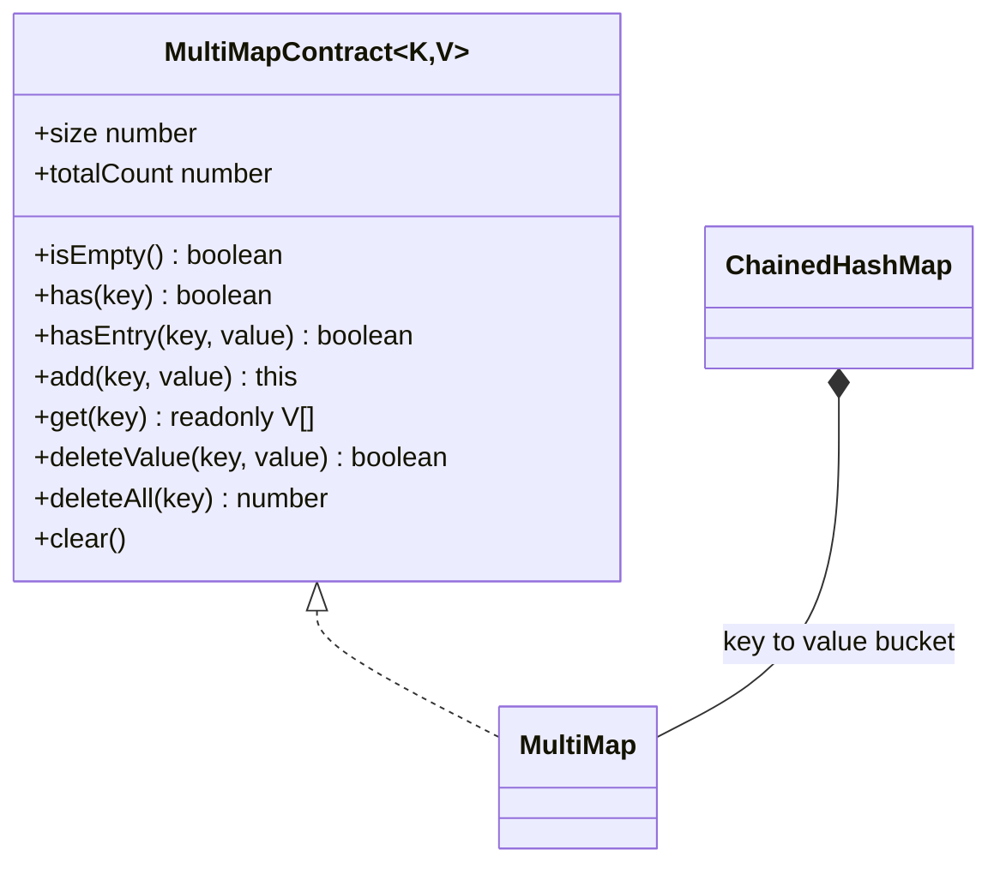
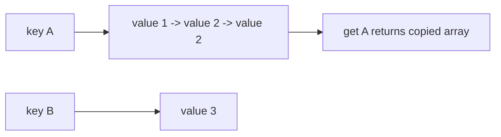
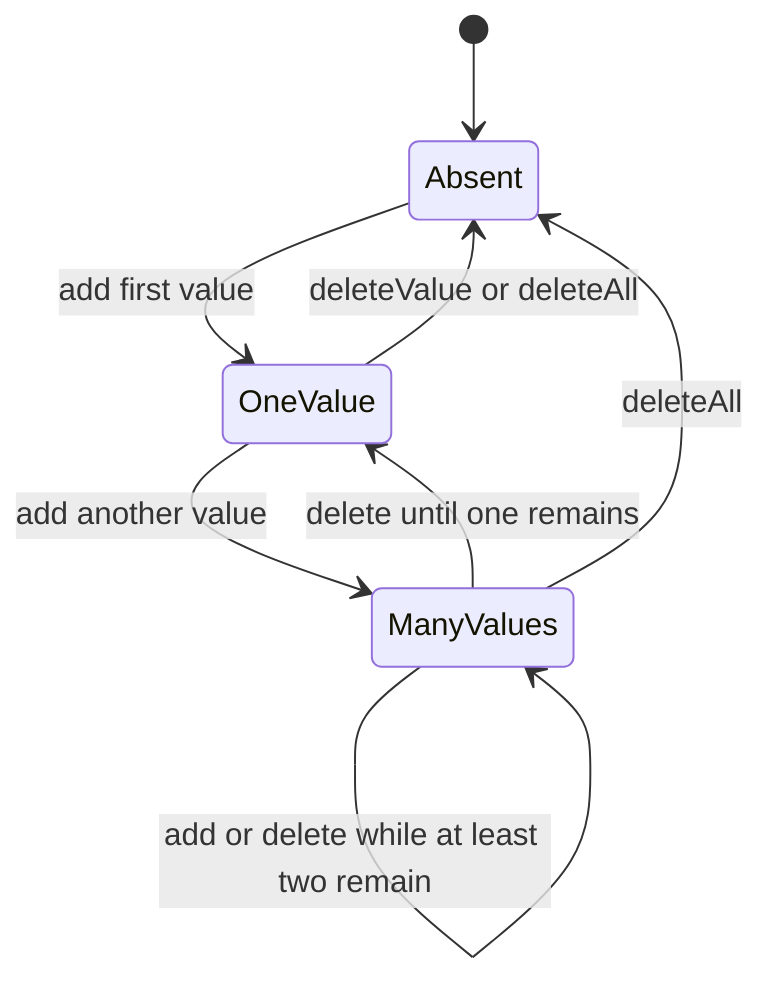

# MultiMap

**Status:** research-audited exercise specification; implementation and tests remain skipped and
are not public.

## Practical ADT

A multimap associates one key with a list of zero or more values. Unlike a normal map, adding a
second value does not replace the first. This list-valued form permits duplicate key-value
associations and preserves value insertion order within each key.

Typical uses include grouping records, inverted indexes, and graph adjacency lists.



## Counts

The two counts answer different questions:

```text
A -> [1, 2, 2]
B -> [3]

size       = 2  distinct keys
totalCount = 4  key-value associations
```

An empty value bucket must never remain stored. Removing the last value also removes its key.

## Proposed API

```ts
new MultiMap<K, V>(
  hash: HashFunction<K>,
  keyEquals?: Equality<K>,
  valueEquals?: Equality<V>,
);
```

Omitted key and value equality both use SameValueZero. The hash function applies only to keys and
must satisfy the Hash Map safe-integer and equality-consistency rules.

## Behavior Rules

1. `add` appends a value to that key's bucket and returns the multimap.
2. Duplicate values are allowed and each increases `totalCount`.
3. `get` returns a new readonly snapshot; changing a casted snapshot must not change the multimap.
4. `get` for an absent key returns a new empty snapshot.
5. `hasEntry` scans only the selected key's values with value equality.
6. `deleteValue` removes the first equal value and returns whether one was removed.
7. `deleteAll` removes a whole key and returns the number of associations removed.
8. Key iteration order is unspecified; value order inside each emitted bucket is insertion order.
9. Structural mutation during active iteration is unsupported.

Separate deletion methods are intentional. An optional `value` parameter would make
`delete(key, undefined)` ambiguous when `undefined` is a legitimate stored value.

## Representation And Operations

Recommended private representation: `ChainedHashMap<K, V[]>` plus a `totalCount` field.





When `deleteValue` removes from the middle of an array bucket, later values shift left. That
operation is linear in the number of values for that key even though locating the key is expected
constant time.

## Expected Complexity

Let `k` be the number of values associated with one key and `n` the total associations.

| Operation | Expected time | Result/extra space |
|---|---:|---:|
| `size`, `totalCount`, `isEmpty` | `O(1)` | `O(1)` |
| `has` | `O(1)` | `O(1)` |
| `add` | amortized `O(1)` | amortized bucket growth |
| `hasEntry` | `O(k)` | `O(1)` |
| `get` | `O(k)` | `O(k)` snapshot |
| `deleteValue` | `O(k)` | `O(1)` |
| `deleteAll` | expected `O(1)` | releases `O(k)` retained values |
| iteration | `O(n)` | emitted snapshots total `O(n)` |
| storage | `O(n)` | keys, buckets, and values |

Hash-map collision worst cases can add `O(size)` key-search work.

## Implementation Guide

1. Complete the chained hash map first.
2. Maintain `size` through the backing map and maintain `totalCount` separately.
3. Allocate a bucket only for the first value of a key.
4. Always return copied arrays from `get` and grouped iteration.
5. Use the value equality callback for `hasEntry` and `deleteValue`.
6. On last-value deletion, remove the backing map key.
7. Test stored `undefined` explicitly to confirm the split deletion API works.

## Traceability

| Concern | Source | Verification |
|---|---|---|
| API and count meanings | `multi-map.contract.ts` | TypeScript and count tests |
| Value-bucket behavior | `MultiMap` in `multi-map.ts` | duplicate/order tests |
| Deletion distinction | `deleteValue`, `deleteAll` | undefined and last-value tests |
| Snapshot isolation | `get` and iterator | mutation-isolation tests |

The tests remain skipped until the owner begins this implementation exercise.
