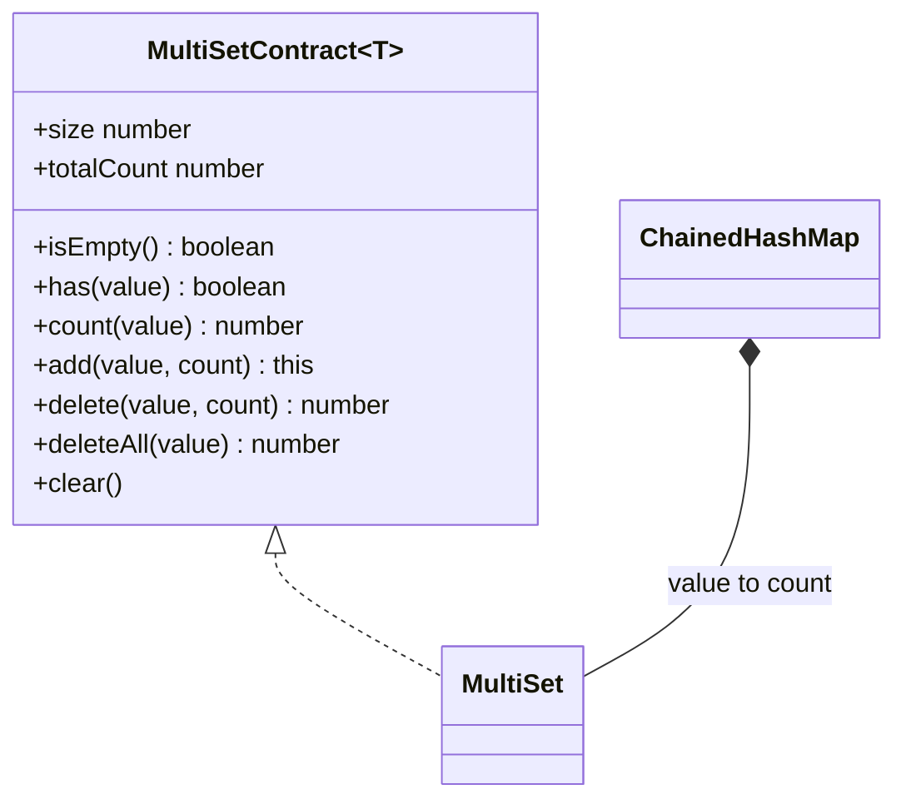
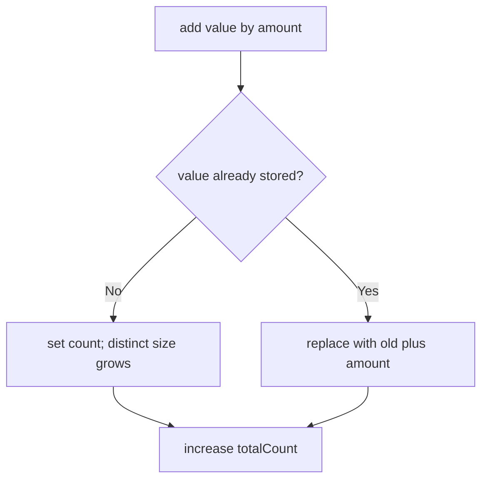
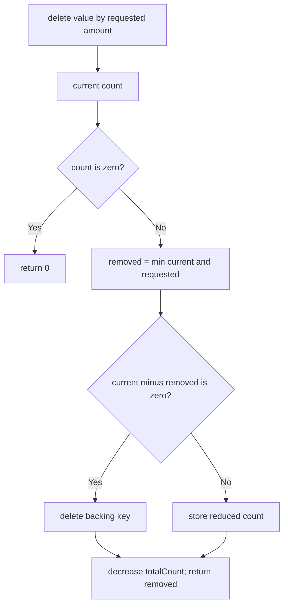

# MultiSet

**Status:** research-audited exercise specification; implementation and tests remain skipped and
are not public.

## Practical ADT

A multiset stores values together with occurrence counts. It is useful for frequency tables,
inventory-like quantities, and algorithms that need duplicates without storing every occurrence as
a separate array element.



## Counts

```text
A -> 3 occurrences
B -> 1 occurrence

size       = 2  distinct values
totalCount = 4  occurrences
count(A)   = 3
count(C)   = 0
```

## Behavior Rules

1. `has(value)` is equivalent to `count(value) > 0`.
2. `add(value, count)` increases both the selected count and `totalCount`.
3. Omitted `count` means one occurrence.
4. Counts passed to `add` or `delete` must be positive safe integers; otherwise throw `RangeError`.
5. `delete(value, count)` removes up to the requested count and returns the actual number removed.
6. Removing the final occurrence also removes the distinct value and decreases `size`.
7. `deleteAll` removes and returns the entire previous count, or zero when absent.
8. Iteration emits one readonly `[value, count]` pair per distinct value.
9. Iteration order is unspecified and follows the backing hash map.
10. Omitted equality uses SameValueZero and hashing follows the Hash Map contract.

Returning the number removed makes partial deletion explicit:

```text
stored count = 2
delete(value, 5) returns 2
new count = 0
```

## Representation

Recommended private representation: `ChainedHashMap<T, number>` plus a `totalCount` field.





## Expected Complexity

| Operation | Expected | Worst case |
|---|---:|---:|
| `size`, `totalCount`, `isEmpty` | `O(1)` | `O(1)` |
| `has`, `count`, `add`, `delete`, `deleteAll` | `O(1)` amortized | `O(n)` hash collision case |
| `clear`, iteration | `O(n)` | `O(n)` |
| Storage | `O(n)` | `O(n)` |

Here `n` is the number of distinct values, not `totalCount`; storing one million occurrences of
one value still needs one map entry.

## Implementation Guide

1. Complete the chained hash map first.
2. Centralize positive-safe-integer validation for requested counts.
3. Update backing counts and `totalCount` together so an exception cannot leave them inconsistent.
4. Delete zero-count keys rather than retaining them.
5. Emit fresh readonly tuples during iteration.
6. Test requests larger than the stored count and totals near `Number.MAX_SAFE_INTEGER`.

The total must remain a safe integer. An addition that would exceed `Number.MAX_SAFE_INTEGER`
throws `RangeError` before changing the multiset.

## Traceability

| Concern | Source | Verification |
|---|---|---|
| API and count meanings | `multi-set.contract.ts` | TypeScript and count tests |
| Backing-map transitions | `MultiSet` in `multi-set.ts` | add/delete lifecycle tests |
| Count validation | `add` and `delete` | invalid/overflow tests |
| Grouped iteration | default iterator | tuple tests |

The tests remain skipped until the owner begins this implementation exercise.
