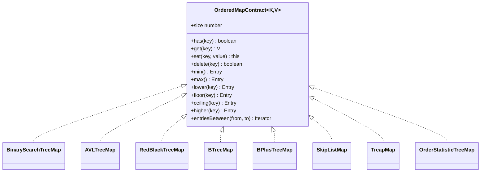
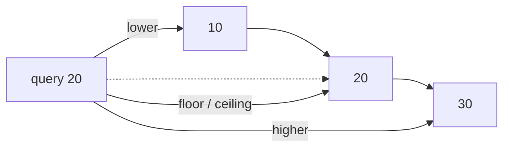

# Ordered Map

**Status:** research-audited exercise specification; implementations and tests remain skipped and
are not public.

## Practical ADT

An ordered map stores one value per comparator-distinct key. Unlike a hash map, it keeps keys in a
defined order and can answer boundary, neighboring-key, and range questions without sorting all
keys for every query.

## Comparator Rules

The supplied `Comparator<K>` defines both order and key equality. A negative result means the left
key comes first, zero means the keys represent the same map entry, and a positive result means the
left key comes later. It must be stable and internally consistent while keys are stored.

When `set` receives a comparator-equal key, it replaces the value but retains the first key object.
This makes object identity predictable. A value may be `undefined`, so use `has` to distinguish a
stored `undefined` from an absent key.

## Neighbor Vocabulary

For a query key `k`:

| Operation | Result |
|---|---|
| `lower(k)` | greatest stored key strictly less than `k` |
| `floor(k)` | greatest stored key less than or equal to `k` |
| `ceiling(k)` | smallest stored key greater than or equal to `k` |
| `higher(k)` | smallest stored key strictly greater than `k` |

Missing boundary or neighbor results are `undefined`. `entriesBetween(from, to)` yields entries in
order and includes either bound when a comparator-equal key exists. It throws `RangeError` when
`from` compares after `to`.

## Correctness Rules

1. `size` counts comparator-distinct keys and is never negative.
2. Search follows the comparator; reference or JavaScript equality does not override it.
3. Replacement changes only the value and does not change `size`.
4. Successful deletion removes exactly one entry and decrements `size` once.
5. Iteration, `keys`, `values`, `entries`, and ranges use comparator order.
6. `clear` removes all entries and leaves the map reusable.
7. Returned entries are snapshots; callers cannot mutate internal nodes through them.
8. Each implementation additionally preserves the structural rules in its focused page.

## Choosing An Implementation

| Implementation | Search/update target | Main reason to study or choose it |
|---|---:|---|
| Plain BST | `O(h)`, worst `O(n)` | simplest ordered-tree baseline |
| AVL tree | worst `O(log n)` | tighter height and lookup-focused workloads |
| Red-black tree | worst `O(log n)` | bounded balance with fewer rotations on many updates |
| Order-statistic tree | worst `O(log n)` | rank and zero-based selection |
| B-tree | worst `O(log n)` node visits | multiway nodes and storage-oriented layouts |
| B+ tree | worst `O(log n + k)` range | linked leaves and efficient sequential ranges |
| Skip list | expected `O(log n)` | probabilistic layered links and simpler local updates |
| Treap | expected `O(log n)` | BST order plus randomized heap priorities |

All structures use `O(n)` stored space. Iterator state is normally proportional to height; a B+
tree range can continue through leaf links after locating its first result. Expected bounds for
skip lists and treaps require a suitable random source.

## Topic Pages

- [Binary Search Tree Map](./binary-search-tree-map/)
- [AVL Tree Map](./avl-tree-map/)
- [Red-Black Tree Map](./red-black-tree-map/)
- [Order-Statistic Tree Map](./order-statistic-tree-map/)
- [B-Tree Map](./b-tree-map/)
- [B+ Tree Map](./b-plus-tree-map/)
- [Skip List Map](./skip-list-map/)
- [Treap Map](./treap-map/)

## Shared Implementation Path

1. Implement comparator search and ordered iteration in the plain BST.
2. Activate the shared contract tests before adding balance logic.
3. Implement AVL, then red-black balancing as independent exercises.
4. Add subtree counts for order statistics.
5. Move to multiway nodes for B-tree and linked leaves for B+ tree.
6. Finish with skip-list levels and treap priorities using injected randomness.
7. Keep every compatible implementation running through `ordered-map.test.ts`.

## Traceability

| Concern | Source | Verification |
|---|---|---|
| Shared public shape | `ordered-map.contract.ts` | TypeScript check |
| Per-implementation guidance | focused topic pages and class comments | owner review |
| Shared observable behavior | all map classes | parameterized contract tests |
| Specialized behavior | constructors, randomness, rank/select | focused tests |

No ordered map is exported until its skipped tests are activated, implemented, and reviewed.
