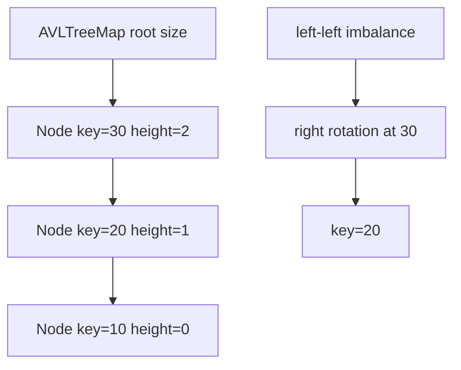

# AVL Tree Map

`AVLTreeMap` keeps the ordered-map behavior while storing each node's height and repairing any node
whose two child heights differ by more than one.

## Correctness Rules

- Binary-search ordering holds at every node.
- A node's recorded height is `1 + max(leftHeight, rightHeight)` under one chosen empty-height rule.
- Each node's balance factor remains `-1`, `0`, or `1` after a public update completes.
- Rotations preserve entry order and all subtree connections.

Insertion retraces its search path, updates heights, and applies one single or double rotation at an
unbalanced ancestor. Deletion may require repairs at several ancestors, so continue toward the root.

Search and neighbor queries are worst-case `O(log n)`. Insert and delete are worst-case `O(log n)`;
iteration is `O(n)`, and stored space is `O(n)`. Rotation work is constant per repaired node.

Implementation lives in `avl-tree-map.ts`. Shared contract tests cover observable behavior; add
focused insertion and deletion sequences for all four rotation shapes while implementing it.
