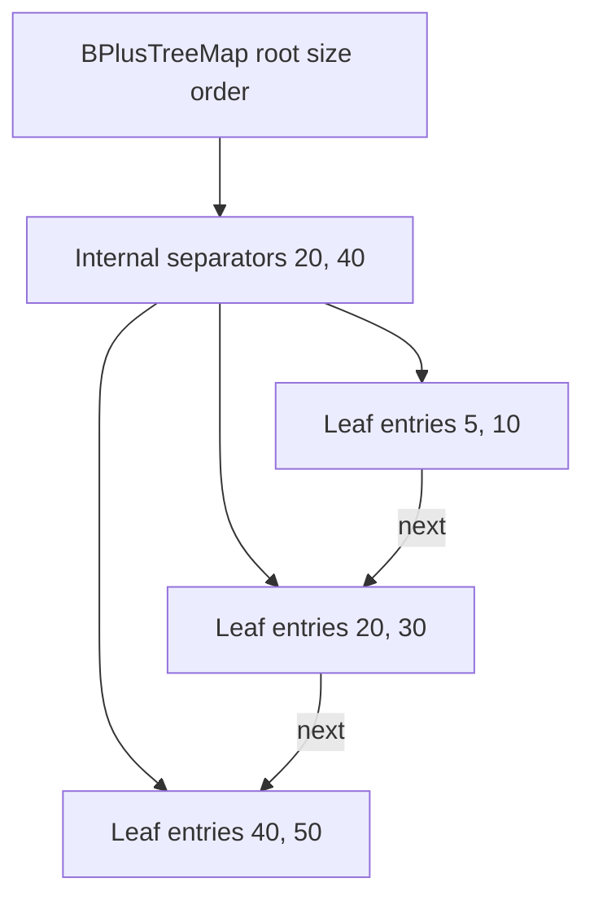
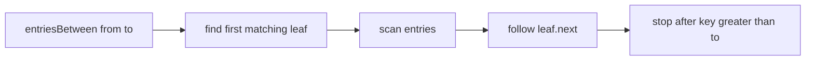

# B+ Tree Map

`BPlusTreeMap` uses internal keys only for routing and stores every key/value entry in leaves. The
leaves form a linked list, making ordered ranges sequential after one initial search. Constructor
`order` is an integer at least `3` and represents the maximum number of children in an internal node.

## Correctness Rules

- Values occur only in leaves; internal separator keys route searches.
- Leaf entries and internal separators remain ordered.
- All leaves have the same depth and are connected in order through `next` links.
- Every non-root node respects the occupancy limits derived from `order`.
- Parent separators continue to represent their child boundaries after split, borrow, or merge.

Insertion splits overflowed leaves or internal nodes and may grow a new root. Deletion repairs
underflow by redistribution or merge, updates affected separator keys, and may collapse a root with
one child.

Point operations are worst-case `O(log n)` node visits. A range yielding `k` entries takes
`O(log n + k)`. Space is `O(n)`, with duplicated separator keys as an engineering cost.

Implementation lives in `b-plus-tree-map.ts`. The shared ordered-map contract runs from
`../ordered-map.test.ts`; constructor, split, redistribution, merge, separator, and linked-leaf
cases live in `b-plus-tree-map.test.ts`.
