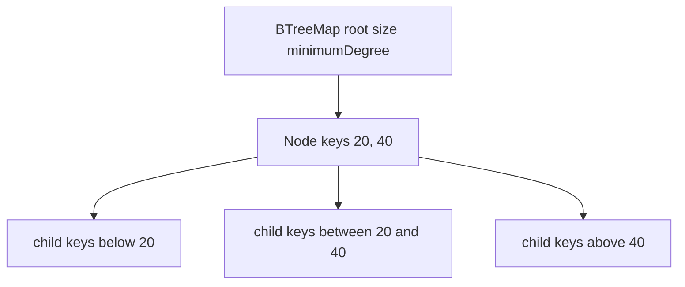
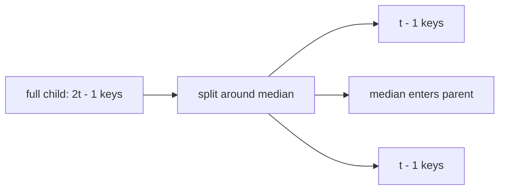

# B-Tree Map

`BTreeMap` stores several sorted entries in each node and uses the gaps between keys to select a
child. Its constructor accepts an integer minimum degree `t >= 2`.

## Correctness Rules

- Keys inside each node are strictly ordered and a node with `m` keys has `m + 1` children unless
  it is a leaf.
- Every non-root node stores from `t - 1` through `2t - 1` keys.
- An internal root stores at least one key; all leaves have the same depth.
- Child ranges agree with the separator keys around them.
- `size` counts entries, not nodes.

Insertion should split a full child before descending into it, promoting its median to the parent.
If the root is full, create a new root and split first. Before deletion descends into a minimally
filled child, borrow from a sibling or merge nodes so the child can safely lose an entry.

Search, insertion, deletion, and neighbors visit `O(log_t n)` nodes, with up to `O(t)` work inside a
simple array-backed node. Range output is `O(log n + k)` at the ADT level. Space is `O(n)`.

Implementation lives in `b-tree-map.ts`. The shared ordered-map contract runs from
`../ordered-map.test.ts`; constructor, split, borrow, merge, root-growth, and root-shrink cases
live in `b-tree-map.test.ts`.
