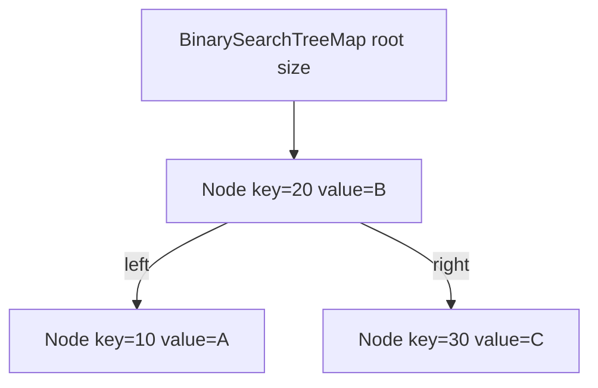
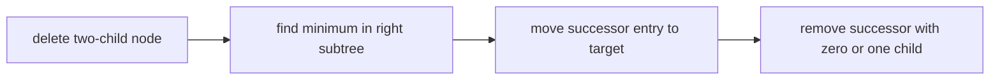

# Binary Search Tree Map

`BinarySearchTreeMap` is the baseline ordered map. Each node owns one entry and up to two children;
it performs no balancing, so its height depends entirely on insertion and deletion history.

## Correctness Rules

- Every key in a node's left subtree compares before the node key.
- Every key in its right subtree compares after the node key.
- Comparator-equal keys occupy one node and replacement retains its key object.
- `size` equals the number of reachable nodes.

## Operations

Search descends left or right from the root. Insert attaches a new leaf at the failed search point.
Deletion has three cases: detach a leaf, connect a one-child node's child to its parent, or replace a
two-child node's entry with its in-order successor and remove that successor.

Search, update, neighbor queries, and initial range positioning take `O(h)` time. Iterating `k`
visited entries takes `O(h + k)` with `O(h)` traversal state. The structure uses `O(n)` storage.
Ordered input can make `h = n`; that limitation is intentional and motivates balanced trees.

Implementation lives in `binary-search-tree-map.ts`. The shared ordered-map contract runs from
`../ordered-map.test.ts`; baseline deletion mechanics live in `binary-search-tree-map.test.ts`.
