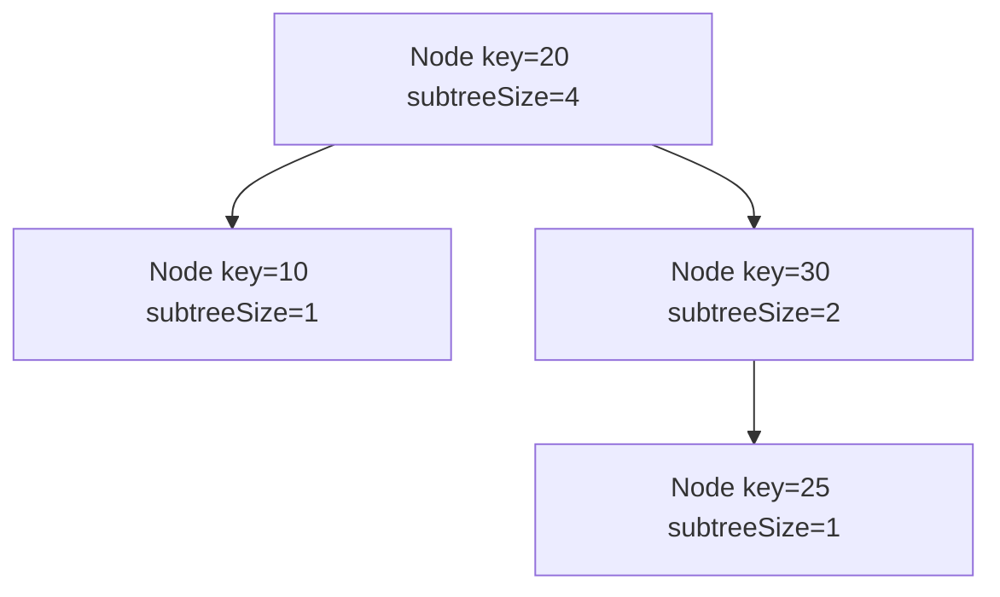
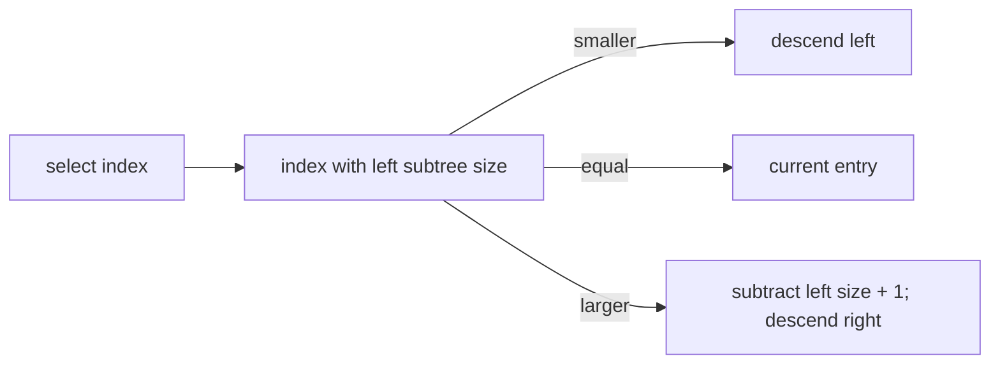

# Order-Statistic Tree Map

`OrderStatisticTreeMap` is a balanced ordered map augmented with each node's subtree entry count.
That count allows indexed selection and rank queries without materializing all keys.

`select(index)` uses a zero-based index and returns the entry at that ordered position. `rank(key)`
returns how many stored keys compare strictly before the query, whether or not the query is stored.
`select` throws `RangeError` for non-integer or out-of-range indices.

## Correctness Rules

- All balancing and search-order rules of the chosen balanced-tree base hold.
- `subtreeSize = 1 + left.subtreeSize + right.subtreeSize` at every node.
- Rotations, insertion, and deletion update counts before a public operation returns.
- Replacing a value does not change any count.

Map operations, `rank`, and `select` are worst-case `O(log n)`; iteration is `O(n)` and stored space
is `O(n)`. Implementation lives in `order-statistic-tree-map.ts`. The shared ordered-map contract
runs from `../ordered-map.test.ts`; rank/select cases live in
`order-statistic-tree-map.test.ts`.
