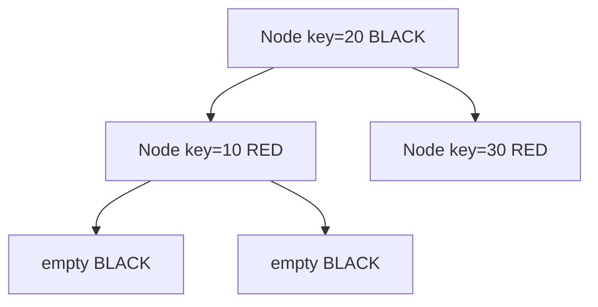

# Red-Black Tree Map

`RedBlackTreeMap` adds one color bit per search-tree node. Its coloring rules limit every root-to-leaf
path to at most twice the length of the shortest path.

## Correctness Rules

- Binary-search ordering holds.
- The root is black and every absent child is treated as black.
- A red node has no red child.
- Every path from one node to an absent descendant contains the same number of black nodes.
- Rotations preserve search order; recoloring preserves the black-path count after repair.

Insertion starts with a red node, then resolves a red parent by recoloring or rotating around its
parent and grandparent. Deletion tracks the removed color; removing black may create a temporary
black deficit repaired with sibling-color cases.

Search, insertion, deletion, and neighbors are worst-case `O(log n)`; iteration is `O(n)` and space
is `O(n)`. Implementation lives in `red-black-tree-map.ts`; shared tests verify map behavior, while
implementation work should add focused recolor, rotation, and deletion-deficit sequences.
