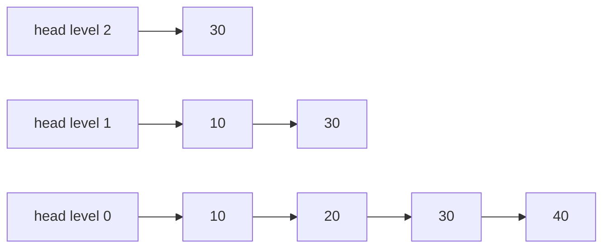
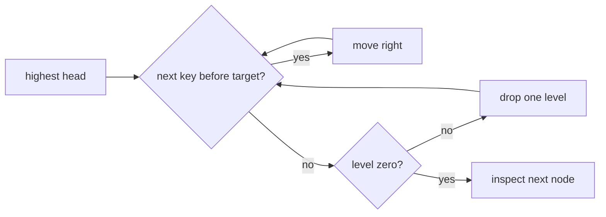

# Skip List Map

`SkipListMap` keeps every entry in a sorted bottom linked list and promotes a random subset into
higher shortcut levels. The constructor accepts an injectable `random` function for deterministic
tests; each sampled value must be in `[0, 1)`.

## Correctness Rules

- Level zero contains every entry exactly once in comparator order.
- Every higher level is an ordered subsequence of the level below it.
- A node's tower is contiguous from level zero to its chosen top level.
- Forward links never move backward or skip a comparator-equal entry.
- The active top level contains at least one node unless the map is empty.

Search starts at the highest head link, moves right while the next key remains before the target,
then drops one level. Insertion records the predecessor at each level and splices in a randomly
sized tower. Deletion reconnects predecessors at every level occupied by the removed node.

Search, insertion, deletion, and neighbors are expected `O(log n)` and worst-case `O(n)`. Iteration
is `O(n)`. Expected storage is `O(n)` forward links; an explicit maximum level prevents unbounded
individual towers.

Implementation lives in `skip-list-map.ts`. The shared ordered-map contract runs from
`../ordered-map.test.ts`; deterministic promotion and random-source validation cases live in
`skip-list-map.test.ts`.
