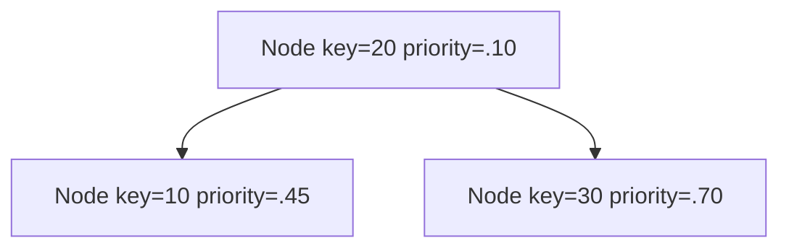
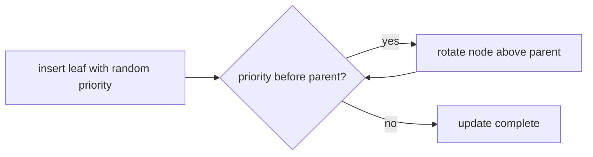

# Treap Map

`TreapMap` gives each inserted key a random priority. Keys obey binary-search-tree order while
priorities obey heap order, so rotations repair priority violations without changing key order.
The injectable random function must return values in `[0, 1)`.

This page assumes smaller numeric priorities rank nearer the root; choosing the opposite direction
is also valid if source, tests, and comments remain consistent.

## Correctness Rules

- Keys satisfy binary-search ordering.
- A parent's priority is no greater than either child's priority.
- A key receives one priority when first inserted; replacing its value retains that priority.
- Random samples are finite values in `[0, 1)`.
- Rotations preserve all entries, child links, and search order.

Insertion first performs ordinary BST insertion, then rotates the new node upward while it violates
priority order. Deletion rotates the target downward by promoting the better-priority child until it
can be detached. Equal priorities need a deterministic tie rule.

With independent useful priorities, search, insertion, deletion, and neighbors are expected
`O(log n)` and worst-case `O(n)`. Iteration is `O(n)` and storage is `O(n)`.

Implementation lives in `treap-map.ts`. The shared ordered-map contract runs from
`../ordered-map.test.ts`; deterministic rotation, deletion, and invalid-random cases live in
`treap-map.test.ts`.
