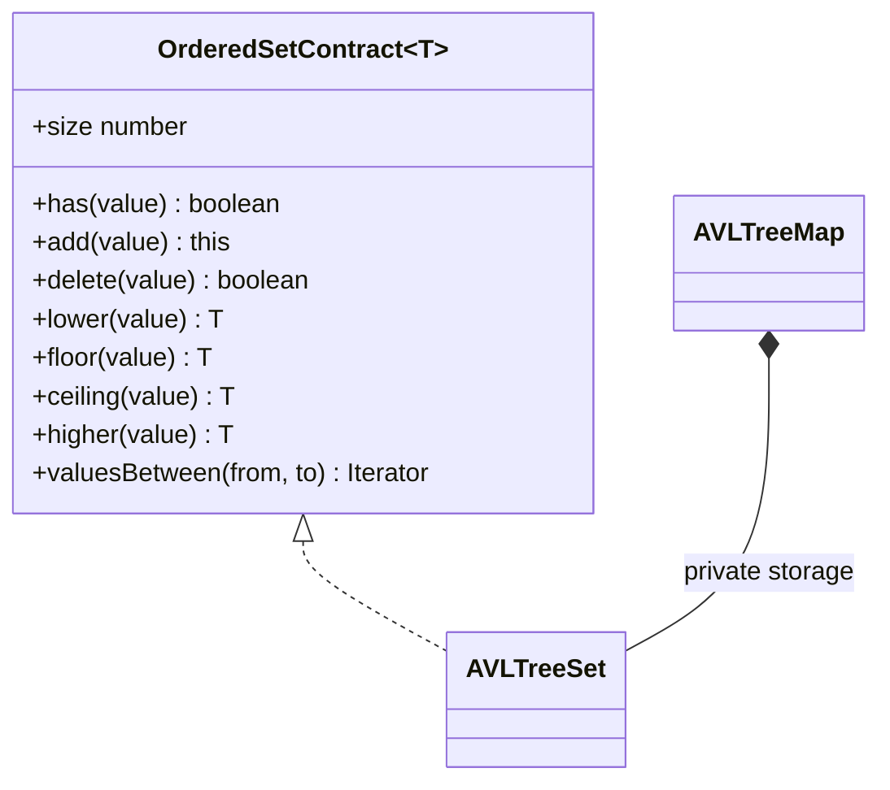
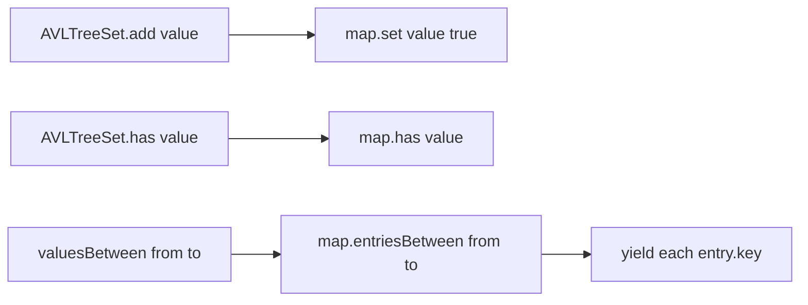

# Ordered Set

**Status:** research-audited exercise specification; implementation and tests remain skipped and
are not public.

## Practical ADT

An ordered set stores one representative of each comparator-equal value and visits values in
comparator order. It combines set membership with useful boundary, neighboring-value, and range
queries.



## Proposed API

```ts
new AVLTreeSet<T>(compare: Comparator<T>);
```

`lower` and `higher` require a strictly smaller or larger value. `floor` and `ceiling` may return a
comparator-equal value. `valuesBetween(from, to)` includes both bounds when matching values exist,
returns values in order, and throws `RangeError` when `from` compares after `to`.

## Correctness Rules

1. Comparator equality, `compare(left, right) === 0`, defines duplicates.
2. Adding a duplicate keeps the first stored representative and does not change `size`.
3. Iteration, `toArray`, and range results follow comparator order.
4. Empty boundary and neighbor queries return `undefined`.
5. `delete` returns `true` only when a comparator-equal value existed.
6. `clear` removes every value and leaves the set reusable.
7. `toArray` returns an independent array.

## Representation

`AVLTreeSet` should own one private `AVLTreeMap<T, true>`. Set operations delegate to map key
operations, and map entries are projected to keys. This is composition, not a second AVL
implementation.



## Expected Complexity

| Operation | Expected and worst-case time | Extra result space |
|---|---:|---:|
| `size`, `isEmpty` | `O(1)` | `O(1)` |
| `has`, `add`, `delete` | `O(log n)` | `O(1)` outside tree storage |
| `min`, `max`, neighbor query | `O(log n)` | `O(1)` |
| range yielding `k` values | `O(log n + k)` | `O(h)` iterator state |
| iteration / `toArray` | `O(n)` | `O(h)` / `O(n)` |
| stored structure | - | `O(n)` |

Here `h` is tree height and remains `O(log n)` for the composed AVL map.

## Implementation Guide

1. Complete `AVLTreeMap` first and keep it as the only balancing implementation.
2. Store the map as a private field with a constant marker value.
3. Delegate membership, updates, boundaries, and neighboring-key queries.
4. Project ordered map entries to values for ranges and iteration.
5. Test comparator-equal objects so first-representative retention is deliberate.

## Traceability

| Concern | Source | Verification |
|---|---|---|
| Public shape | `ordered-set.contract.ts` | TypeScript check |
| Map composition | `AVLTreeSet` in `ordered-set.ts` | delegation behavior tests |
| Neighbor semantics | `lower`, `floor`, `ceiling`, `higher` | boundary tests |
| Inclusive ranges | `valuesBetween` | range and reversed-bound tests |

The tests remain skipped until the owner activates this exercise.
