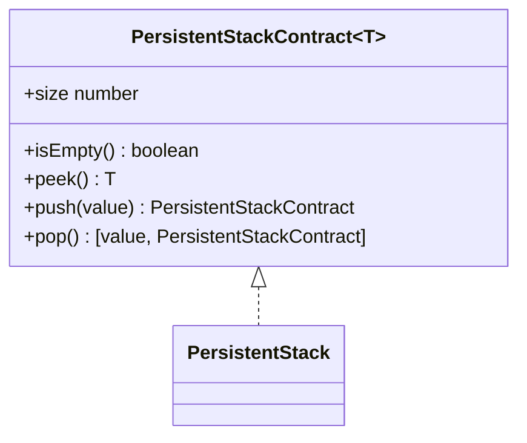
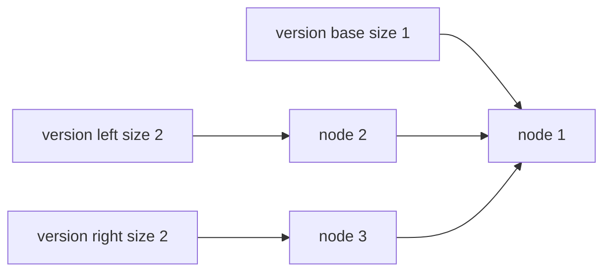

# Persistent Stack

**Status:** research-audited elective specification; implementation and tests remain skipped and
are not public.

`PersistentStack<T>` is immutable: `push` and `pop` produce or reveal another version while every
older version remains usable. It is persistent in the data-structure sense, not disk storage.

## Structural Sharing

Each nonempty version points to one immutable top node. Pushing allocates one node whose `next`
points at the previous top. Popping returns the already-existing tail version rather than copying
remaining values.

## Correctness Rules

- No operation mutates a node or version reachable from an earlier stack.
- `push` returns size plus one and leaves the receiver unchanged.
- Nonempty `pop` returns the top value and the shared tail version.
- Empty `pop` returns `[undefined, sameStack]`.
- Stored `undefined` is valid; `size` or `isEmpty` disambiguates it from empty state.
- Iteration runs top to bottom for that stable version.

`size`, `isEmpty`, `peek`, `push`, and `pop` take `O(1)` time. A push allocates `O(1)` storage;
versions share tails. Iteration takes `O(n)` time and `O(1)` auxiliary state.

Implementation lives in `persistent-stack.ts`; tests cover empty identity, preserved versions,
branching histories, shared-tail pop identity, iteration, and stored `undefined`.
