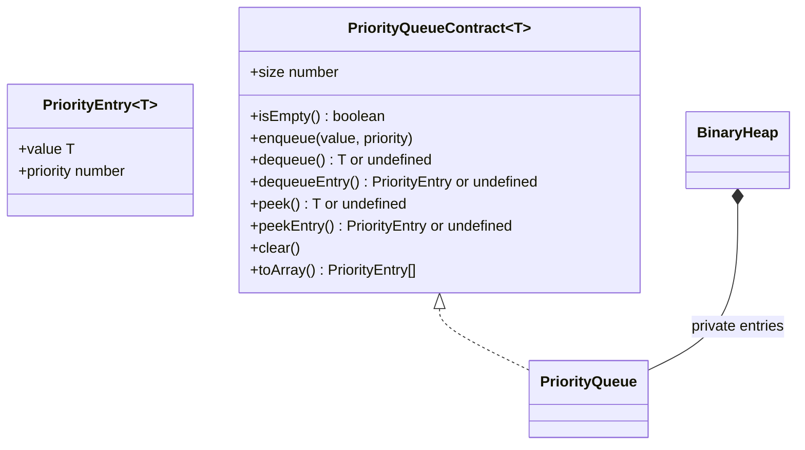
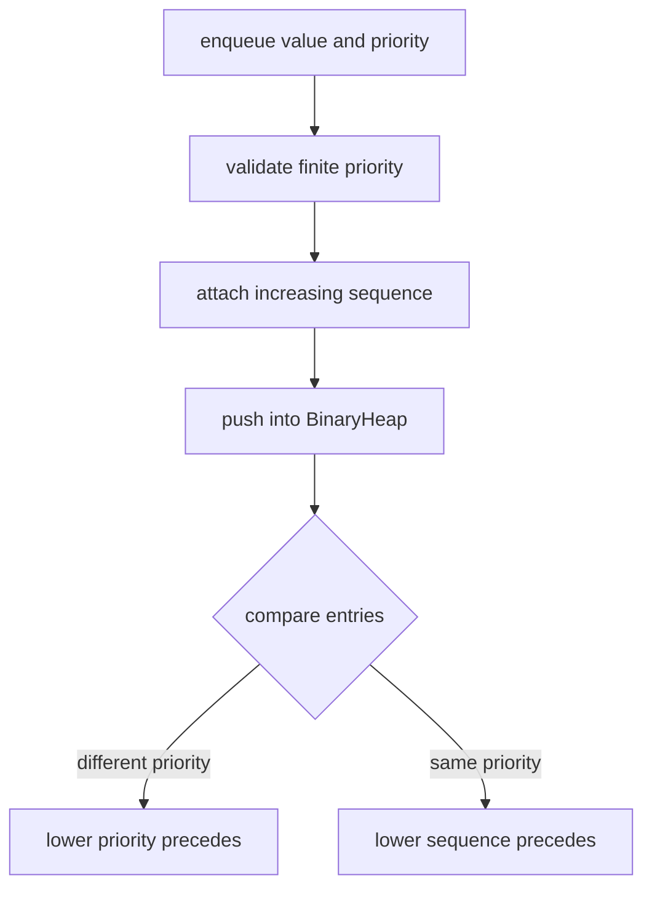
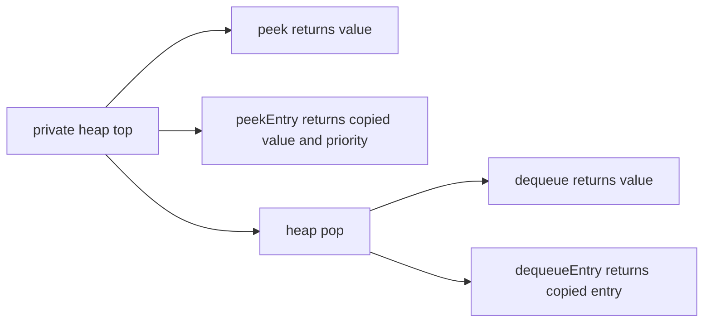

# Priority Queue

**Status:** research-audited exercise specification; implementation and tests remain skipped and
are not public.

## Practical ADT

A priority queue removes the most urgent value rather than the oldest value. AlgoHatch uses a
common scheduling convention:

- Lower numeric priority is processed first.
- Equal priorities are processed in FIFO insertion order.

```text
enqueue("normal", 5)
enqueue("urgent A", 1)
enqueue("urgent B", 1)

dequeue order: urgent A, urgent B, normal
```



## Behavior Rules

1. Empty peek and dequeue methods return `undefined`.
2. Priority must be a finite number; `NaN` and infinities throw `RangeError` before mutation.
3. Negative priorities and fractional priorities are valid.
4. Lower numeric priority comes first.
5. Equal priorities retain FIFO insertion order.
6. `peek` and `dequeue` return only the stored value.
7. Entry variants return fresh `{ value, priority }` snapshots.
8. `toArray` and iteration return entry snapshots in dequeue order without changing the queue.
9. Structural mutation during active iteration is unsupported.

## Heap Representation

Recommended private heap item:

```ts
interface StoredPriorityEntry<T> {
  value: T;
  priority: number;
  sequence: number;
}
```

The sequence is private. It breaks priority ties but is never exposed to callers.



When the queue becomes empty, the implementation may reset its sequence counter. It must reject or
renormalize before any counter exceeds the safe-integer range.

## Value And Entry Views



Returning snapshots prevents callers from changing a stored priority without restoring heap order.

## Expected Complexity

| Operation | Time | Extra/result space |
|---|---:|---:|
| `size`, `isEmpty`, `peek`, `peekEntry` | `O(1)` | `O(1)` |
| `enqueue`, `dequeue`, `dequeueEntry` | `O(log n)` | `O(1)` beyond heap growth |
| `clear` | `O(n)` | `O(1)` |
| `toArray`, full iteration | `O(n log n)` | `O(n)` |
| retained storage | `O(n)` | `O(n)` |

## Implementation Guide

1. Complete `BinaryHeap` first.
2. Define a private stored-entry type that includes the sequence number.
3. Centralize the priority-then-sequence comparator.
4. Validate priority before incrementing sequence or mutating the heap.
5. Implement entry-returning methods first; value-only methods can unwrap those results.
6. Use the heap's sorted snapshot behavior for iteration and `toArray`.
7. Test equal priorities heavily; ordinary heap comparison alone does not provide FIFO ties.

## Trade-Offs

The stable tie rule costs one private sequence number per entry. A heap without it uses slightly
less metadata but can reorder equally urgent tasks unpredictably. Updating or removing arbitrary
queued entries is intentionally absent from this first contract because efficient support requires
an additional index from caller handles to heap positions.

## Traceability

| Concern | Source | Verification |
|---|---|---|
| API and entry shape | `priority-queue.contract.ts` | TypeScript check |
| Priority/tie ordering | `PriorityQueue` in `priority-queue.ts` | mixed-priority tests |
| Entry isolation | peek/dequeue entry methods | snapshot tests |
| Heap composition | private `BinaryHeap` | stress and order tests |

The tests remain skipped until the owner begins this implementation exercise.
