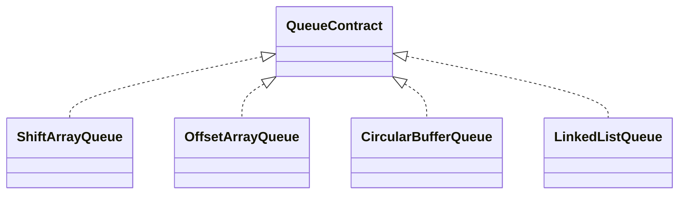

# Queue

A queue removes values in first-in, first-out (FIFO) order. Values enter at the back and leave from
the front. This family README owns the shared ADT; each implementation folder owns its mechanics.

## Status

- Research audit, shared contract, comparison, guidance, and skipped tests prepared
- Four implementations intentionally incomplete and not exported

## Behavior Contract

1. `enqueue(value)` adds at the logical back.
2. `peek()` reads the logical front without mutation.
3. `dequeue()` removes and returns the logical front.
4. Empty `peek()` and `dequeue()` return `undefined` without mutation.
5. Stored `undefined` is valid; `size` distinguishes it from emptiness.
6. Iteration and `toArray()` run front-to-back, and `toArray()` is an independent snapshot.
7. `clear()` releases retained values and leaves the queue reusable.
8. Structural mutation during active iteration is unsupported.
9. Capacity, indexes, compaction thresholds, and nodes are private.

```ts
interface QueueContract<T> extends Iterable<T> {
  readonly size: number;
  isEmpty(): boolean;
  enqueue(value: T): void;
  dequeue(): T | undefined;
  peek(): T | undefined;
  clear(): void;
  toArray(): T[];
}
```



## Implementations

- [ShiftArrayQueue](./shift-array-queue/): simplest baseline; dequeue shifts later values.
- [OffsetArrayQueue](./offset-array-queue/): advances a front offset and occasionally compacts.
- [CircularBufferQueue](./circular-buffer-queue/): wraps logical order across indexed storage.
- [LinkedListQueue](./linked-list-queue/): keeps direct head and tail node links.

| Operation | Shift array | Offset array | Circular buffer | Linked list |
|---|---:|---:|---:|---:|
| `size`, `isEmpty`, `peek` | Worst `O(1)` | Worst `O(1)` | Worst `O(1)` | Worst `O(1)` |
| `enqueue` | Amortized `O(1)` | Amortized `O(1)` | Amortized `O(1)` | Worst `O(1)` |
| `dequeue` | Worst `O(n)` | Amortized `O(1)` | Worst `O(1)` | Worst `O(1)` |
| `clear`, iteration, snapshot | Worst `O(n)` | Worst `O(n)` | Worst `O(n)` | Worst `O(n)` |

All implementations retain `O(n)` logical storage. The shared behavior suite is `queue.test.ts`;
implementation-specific tests belong in the matching child folder when concrete code is activated.
