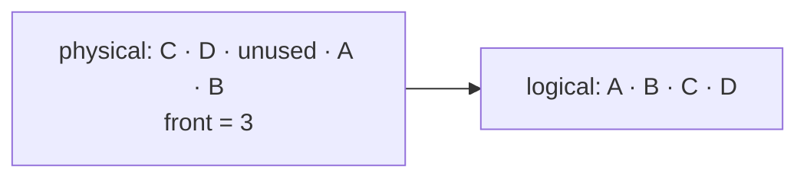

# CircularBufferQueue

`CircularBufferQueue<T>` maps logical FIFO order onto wrapped indexed storage.

Enqueue and dequeue move indexes with wrap-around instead of shifting values. When full, growth
allocates larger storage, copies values front-to-back into contiguous order, and resets the front.
Operations are normally `O(1)`; enqueue is amortized `O(1)` with an occasional `O(n)` growth copy.

**Implementation guide:** choose one empty-index convention, distinguish logical size from capacity,
clear removed slots, and test wrap-around before growth. Source is `circular-buffer-queue.ts`; shared
transition coverage is in `../queue.test.ts`.
