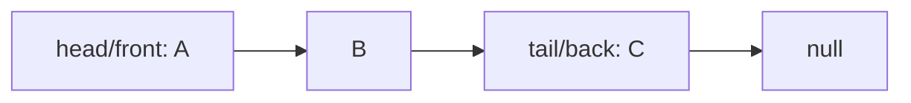

# LinkedListQueue

`LinkedListQueue<T>` keeps a head for the logical front and a tail for the logical back.

Enqueue links after the tail; dequeue advances the head. Both are worst-case `O(1)`. Storage is
`O(n)` with one node and next link per value, trading locality for no resize or compaction step.

**Implementation guide:** empty-to-one enqueue must set both ends; one-to-empty dequeue must clear
both ends; removed nodes must not retain the queue. Source is `linked-list-queue.ts`; shared FIFO
behavior is in `../queue.test.ts`.
