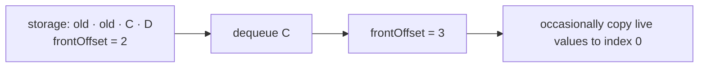

# OffsetArrayQueue

`OffsetArrayQueue<T>` keeps values in an array but advances a private front offset instead of
shifting live values on every dequeue.

Normal dequeue is `O(1)`; occasional compaction is `O(n)`, making dequeue amortized `O(1)`.
Compaction thresholds remain private so they can change without affecting callers.

**Implementation guide:** clear removed references, derive size from live values rather than raw
array length, reset storage after the final dequeue, and compact only when retained prefix waste is
meaningful. Source is `offset-array-queue.ts`; shared behavior is in `../queue.test.ts`.
