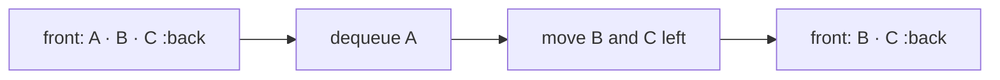

# ShiftArrayQueue

`ShiftArrayQueue<T>` is the simplest queue baseline: enqueue appends to a native array and dequeue
removes physical index zero.

`enqueue`, `peek`, and size checks are expected `O(1)` under the ordinary array model; `dequeue` is
worst-case `O(n)` because later values shift. It is useful for understanding the ADT and for very
small queues, not as the general default.

**Implementation guide:** keep one private array, clear all values on `clear`, and expose logical
front-to-back snapshots. Source is `shift-array-queue.ts`; shared FIFO behavior is verified by
`../queue.test.ts`.
