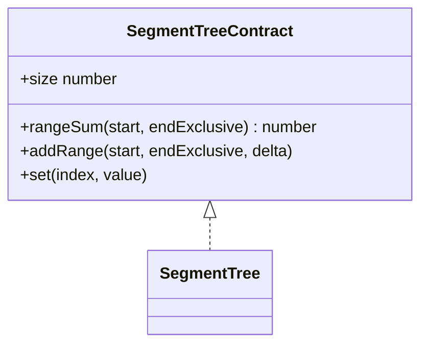
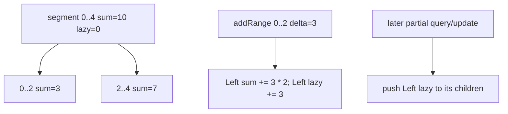

# Segment Tree

**Status:** research-audited exercise specification; implementation and tests remain skipped and
are not public.

`SegmentTree` maintains finite numeric range sums while supporting point assignment and adding one
delta to every value in a half-open range.

## Lazy Representation

Each node covers one half-open segment and stores its sum. A parallel lazy value records an
addition already reflected in that node's sum but not yet applied to its children.

## Correctness Rules

1. A node sum equals the conceptual sum of its segment, including its own deferred addition.
2. Applying delta to a fully covered node adds `delta * segmentLength` to its sum.
3. Before partial descent, push a node's lazy delta to both children and clear it at the parent.
4. After child modification, recompute the parent as the sum of its children.
5. Empty valid ranges have sum zero and range addition is a no-op.
6. Constructor values, assignments, and deltas must be finite; indexes/ranges are validated.

Building from the input snapshot takes `O(n)` time. Range sum, range addition, and point assignment
take `O(log n)` time; array-backed tree and lazy storage use `O(n)` space.

## Implementation Guide

1. Keep recursive helper segments half-open to match the public API.
2. Centralize full-cover delta application in one helper.
3. Centralize lazy push before every partial query or update.
4. Implement `set` as a true assignment after pending additions, not as an unadjusted delta.
5. Treat an empty input as a valid tree with only the range `[0, 0)`.

Implementation lives in `segment-tree.ts`; tests cover overlapping updates, partial sums, point
assignment after laziness, empty storage, snapshots, and validation.
