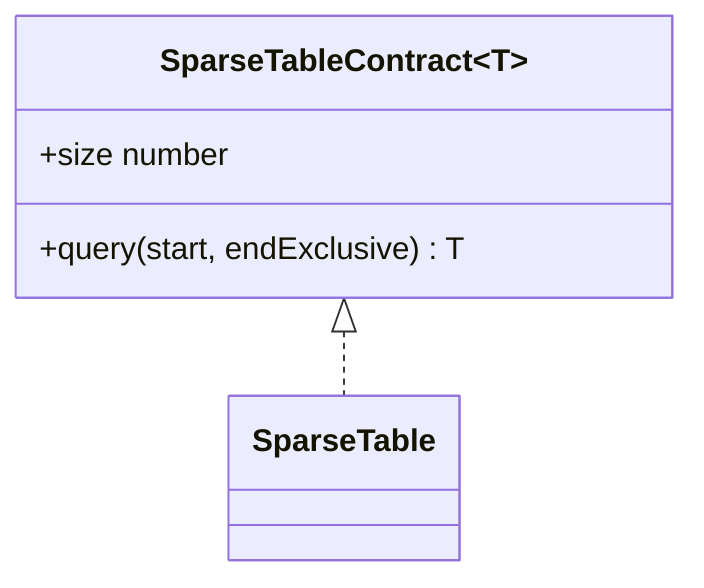
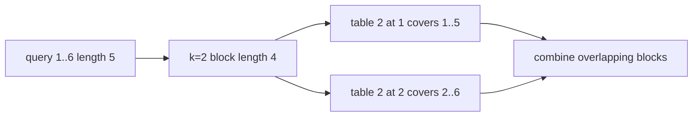

# Sparse Table

**Status:** research-audited exercise specification; implementation and tests remain skipped and
are not public.

`SparseTable<T>` preprocesses an immutable value snapshot for repeated nonempty half-open range
queries. Its `O(1)` query method requires an associative and idempotent combine operation, such as
minimum, maximum, greatest common divisor, or bitwise AND.

Associative means regrouping does not change a result. Idempotent means combining a value with
itself returns that value. The class cannot prove these properties for an arbitrary callback, so
they are a caller responsibility. Addition is associative but not idempotent and is not valid for
this overlapping-block query strategy.

## Representation

Row `k` stores results for every interval of length `2^k`. Query length chooses
`k = floor(log2(length))`; combine the block beginning at `start` with the block ending at
`endExclusive`. They may overlap because duplicate contribution is harmless under idempotence.

## Correctness Rules

- The constructor snapshots values and never supports updates.
- `table[k][i]` combines exactly the input range `[i, i + 2^k)`.
- Queries must be nonempty safe-integer ranges within bounds; invalid input throws `RangeError`.
- Empty construction is valid but has no valid query.
- `combine` must be deterministic, associative, and idempotent for all stored values.

Build time and storage are `O(n log n)`. Query time is `O(1)` with `O(1)` auxiliary space.

Implementation lives in `sparse-table.ts`; tests cover min/max, singleton and full ranges, input
snapshots, empty construction, and range validation.
