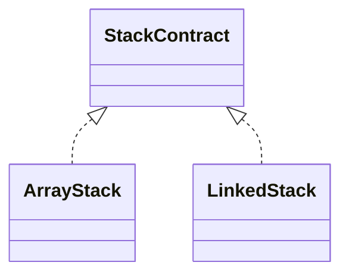

# Stack

A stack removes the newest value first: last in, first out (LIFO). The shared contract describes
logical top-to-bottom behavior independently from storage.

## Behavior Contract

1. `push` makes a value the new top; `peek` reads it; `pop` removes it.
2. Empty `peek` and `pop` return `undefined` without mutation.
3. Stored `undefined` is valid and is distinguished with `size`.
4. Iteration and `toArray()` run top-to-bottom in repeated-pop order.
5. Snapshots are independent and `clear()` leaves the stack reusable.
6. Structural mutation during active iteration is unsupported.

## Implementations

- [ArrayStack](./array-stack/): compact indexed storage with the top at the logical end.
- [LinkedStack](./linked-stack/): a top node whose links point toward the bottom.

| Operation | Array stack | Linked stack |
|---|---:|---:|
| size, emptiness, peek | Worst `O(1)` | Worst `O(1)` |
| push | Amortized `O(1)` | Worst `O(1)` |
| pop | Worst `O(1)` | Worst `O(1)` |
| clear, iteration, snapshot | Worst `O(n)` | Worst `O(n)` |

Both use `O(n)` retained storage. Shared LIFO and boundary behavior is in `stack.test.ts`.
