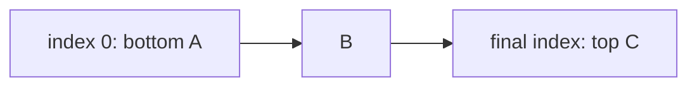

# ArrayStack

`ArrayStack<T>` stores bottom-to-top, with the top at the final logical array index.

Peek and pop are worst-case `O(1)`; push is amortized `O(1)` under geometric native-array growth.
The array may retain unused capacity but avoids one node allocation per value.

**Implementation guide:** push/pop only at the logical end, clear removed references, and reverse
storage order when producing top-to-bottom iteration or snapshots. Source is `array-stack.ts`;
shared behavior is in `../stack.test.ts`.
