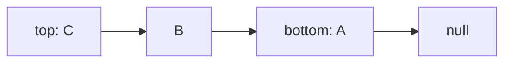

# LinkedStack

`LinkedStack<T>` points directly to the top node; each node points toward the value below it.

Push, peek, and pop are worst-case `O(1)`. Storage is `O(n)` with one node and link per value,
avoiding resize copies at the cost of allocation and weaker locality.

**Implementation guide:** push links a new node to the old top; pop advances top and detaches the
old node; clearing drops all reachable nodes. Source is `linked-stack.ts`; shared behavior is in
`../stack.test.ts`.
