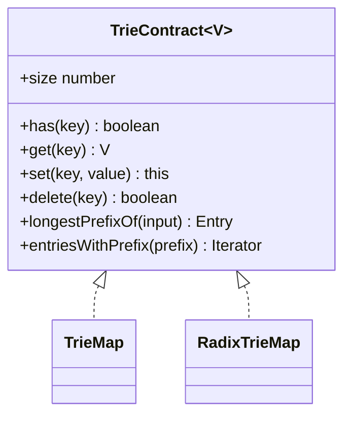
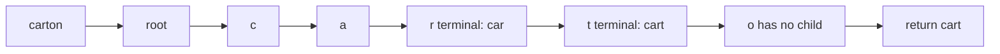
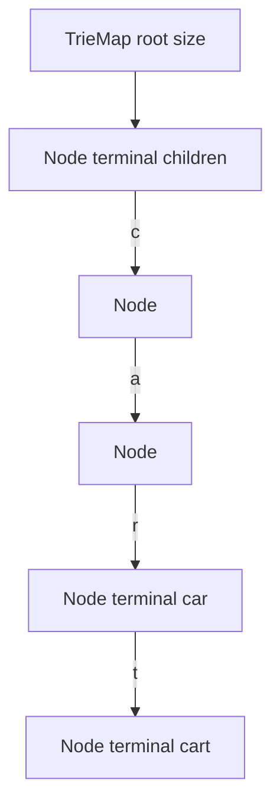

# Trie Map

**Status:** research-audited exercise specification; implementations and tests remain skipped and
are not public.

## Practical ADT

A trie map stores string keys by shared prefixes. `TrieMap` uses one edge per Unicode code point;
`RadixTrieMap` compresses non-branching paths into longer edge labels. Both expose the same map and
prefix-query contract.



## String Model

AlgoHatch takes one trie step per Unicode code point, matching JavaScript string iteration. A
supplementary-plane symbol therefore occupies one edge even though its UTF-16 representation uses
two code units. A code point is still not necessarily one user-perceived character; grapheme
segmentation is deliberately outside this data structure.

Keys are exact strings. The trie does not change case, apply locale rules, or normalize Unicode.
For example, a precomposed accented letter and the equivalent base-letter-plus-combining-mark
sequence remain distinct unless the caller normalizes both before using the map.

## Proposed API

```ts
new TrieMap<V>();
new RadixTrieMap<V>();
```

Both implement `TrieContract<V>`. The empty string is a valid key represented by a terminal value
at the root. Because `undefined` is also a valid stored value, use `has` to test presence.

`entriesWithPrefix(prefix)` includes an entry equal to the prefix and returns all matching entries.
An empty prefix enumerates the whole map. `longestPrefixOf(input)` finds the longest stored key that
is a prefix of the input, not the longest common prefix in the map.



## Ordering

Iteration and prefix results use lexicographic order by numeric Unicode code-point sequence. A key
comes before its proper extensions. This deterministic order can differ from JavaScript's raw
UTF-16 relational ordering for some supplementary-plane strings.

## Correctness Rules

1. `size` counts stored keys, including the empty key when present.
2. A path alone does not imply membership; only a terminal with a stored value marks a key.
3. Replacing a key's value does not change `size`.
4. Deleting a key cannot remove another key that shares its prefix or extends it.
5. Prefix enumeration returns every and only matching key in the documented order.
6. Returned tuple entries are snapshots, not mutable internal nodes.
7. `clear` resets all paths and leaves the map reusable.

## Ordinary Representation



Each node should store child transitions keyed by one code-point string plus a separate terminal
presence flag. A separate flag is necessary because the stored value may itself be `undefined`.

## Expected Complexity

Let `u` be a key or prefix length in Unicode code points and let `r` be the total code points in
reported keys.

| Operation | Expected time | Extra space |
|---|---:|---:|
| `has`, `get`, replacement | `O(u)` | `O(1)` traversal state |
| insert new key | `O(u)` | `O(u)` new nodes worst case |
| `delete` | `O(u)` | `O(u)` path state |
| `longestPrefixOf` | `O(u)` | `O(1)` excluding returned key |
| prefix enumeration | `O(u + r)` plus child ordering | proportional to traversal depth |
| full iteration | `O(r)` plus child ordering | proportional to traversal depth |

Expected bounds assume expected `O(1)` child-map transitions. Reading the original JavaScript
string still depends on its UTF-16 code-unit representation. Both implementations use storage
proportional to the total retained key material; their constants differ substantially.

## Implementation Guide

1. Implement `TrieMap` first using code-point string iteration.
2. Keep terminal presence separate from terminal value.
3. Record the traversed path during deletion, then prune useless nodes from the bottom upward.
4. Produce deterministic code-point ordering without confusing it with UTF-16 string comparison.
5. Implement and test the shared API before beginning compressed edges.
6. Continue with the focused [Radix Trie](./radix-trie-map/) exercise.

## Traceability

| Concern | Source | Verification |
|---|---|---|
| Shared API | `trie.contract.ts` | TypeScript check |
| Ordinary representation | [`TrieMap`](./trie-map/) | shared and deletion tests |
| Compressed representation | [`RadixTrieMap`](./radix-trie-map/) | shared and focused split tests |
| Unicode and ordering policy | both implementations | supplementary and normalization tests |

The suites remain skipped until the owner activates this topic.
