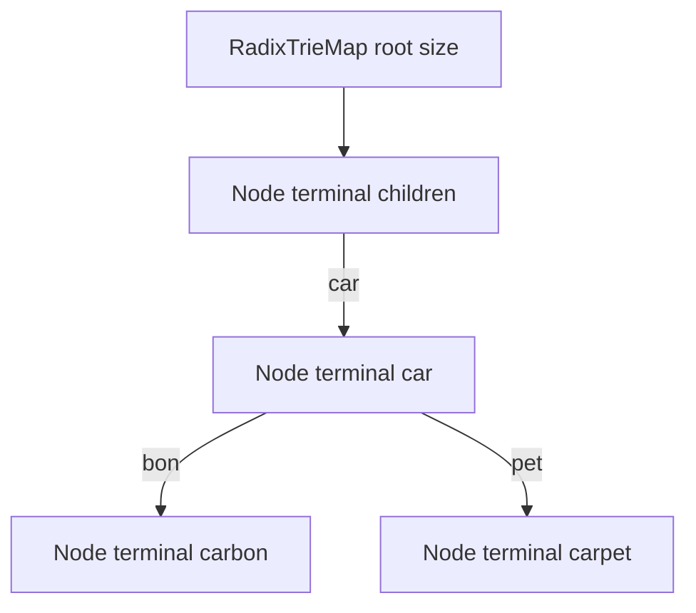
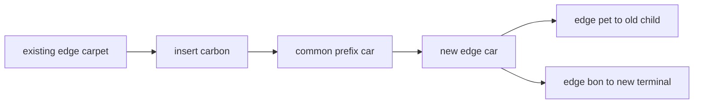

# Radix Trie Map

`RadixTrieMap` preserves the Trie Map ADT while replacing each nonterminal one-child path with one
edge labeled by several Unicode code points. The practical benefit is fewer nodes for long shared
strings; the cost is more involved insertion, deletion, and prefix matching.

The edge labels above correspond to the full keys `car`, `carbon`, and `carpet`. Labels are
nonempty sequences of whole code-point tokens.

## Correctness Rules

- Sibling edge labels begin with different code points.
- Concatenating labels from the root to a terminal reconstructs exactly one stored key.
- A non-root, nonterminal node never has exactly one child after an update completes; such a path
  must be merged.
- Splitting or merging occurs only at code-point boundaries.
- A prefix query may finish at a node or partway through an edge label.

## Insertion Splits

Compare the remaining key with the chosen edge label and find their longest common code-point
prefix. Four outcomes matter: full label match and descend, exact key replacement, new key ending
inside the label, or both strings continuing after a partial match.

## Deletion Cleanup

Clear the exact terminal first. Remove a now-empty leaf. If its parent becomes a nonterminal with
one child, concatenate the incoming and outgoing labels and bypass that parent. Continue upward
until no more cleanup is needed.

Exact operations compare at most the key's code points along one path, targeting `O(u)` expected
time with expected constant-time first-token child selection. Splits and merges allocate label
fragments. Prefix enumeration costs the prefix search plus reported key material and ordering work.

Implementation lives in `radix-trie-map.ts`. The shared trie contract runs from
`../trie.test.ts`; compressed-edge, split, merge, empty-key, and supplementary-code-point cases
live in `radix-trie-map.test.ts`.
